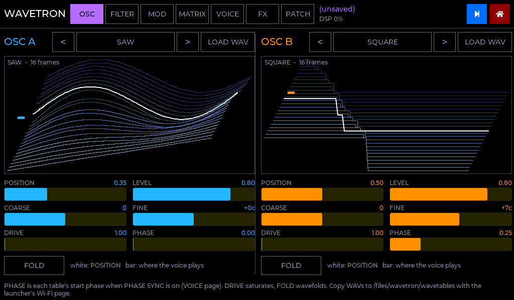
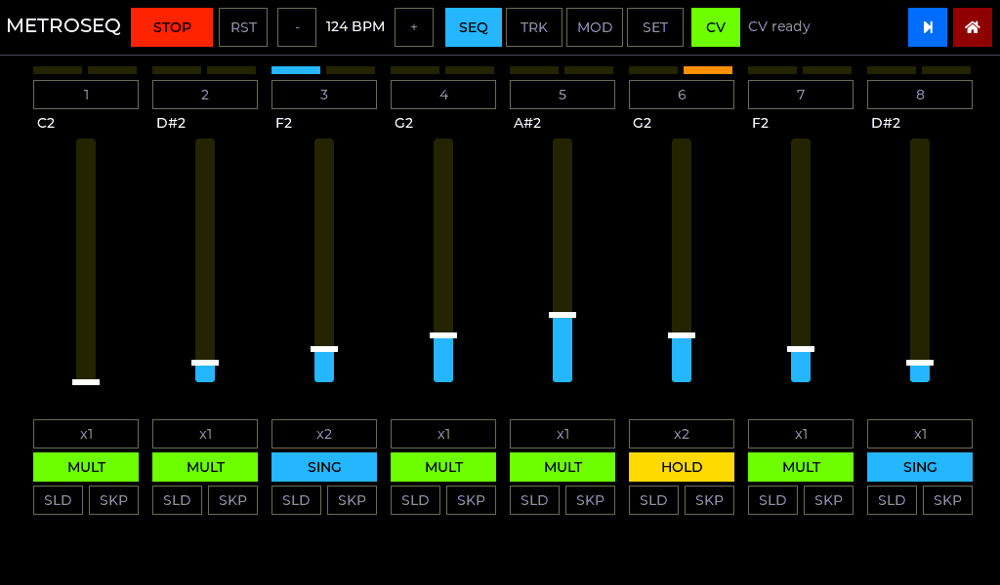
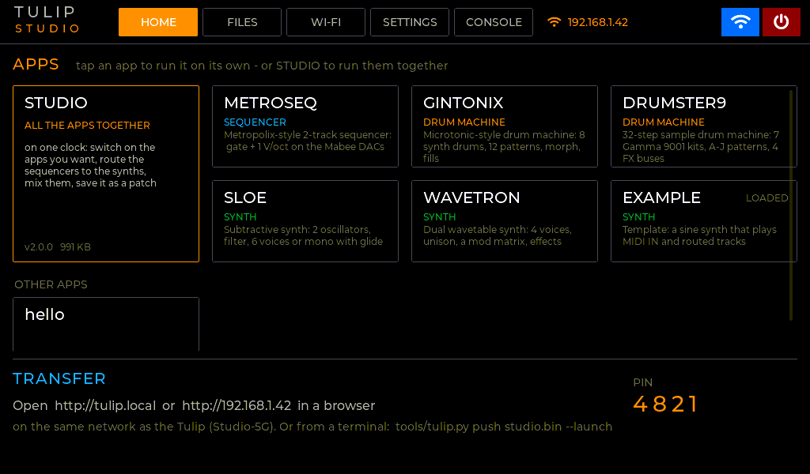
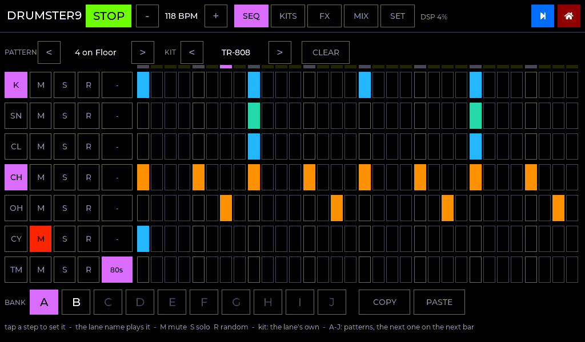
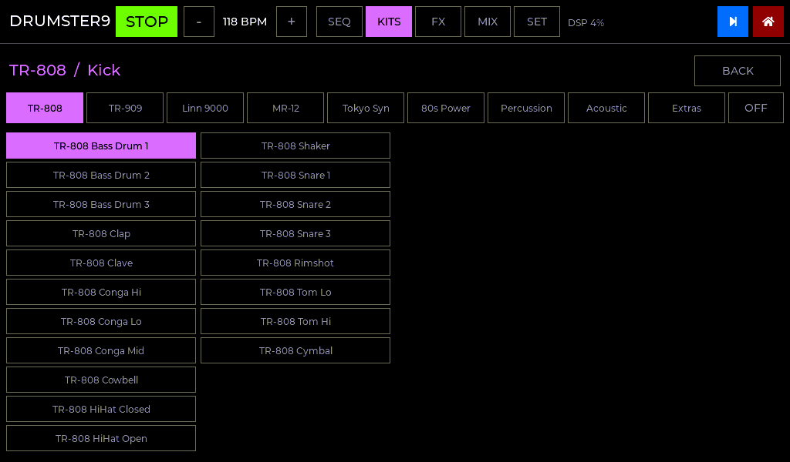

# TULIP STUDIO

Native ESP32-S3 firmware for the [Tulip Creative Computer](https://github.com/shorepine/tulipcc),
with no MicroPython or AMY.

**One set of apps, two ways to run them.** The start page has two sections:

* **The apps, each on its own:** metroseq (sequencer), GinTonix and Drumster9 (drum
  machines), Sloe and Wavetron (synths).
* **STUDIO:** the same apps together on one clock. Every app starts off; you switch on
  the ones you want.

The apps are written once, against one runtime ([docs/APPS.md](docs/APPS.md)). Each
gets the clock, MIDI and CV services for its role:

| Role | Gets |
|---|---|
| **Drum machines** | a CV clock out, MIDI IN, MIDI clock out (and in) |
| **Sequencers** | CV gate and pitch, MIDI OUT, MIDI clock in and out |
| **Synths** | MIDI IN, and notes from any sequencer track routed to them |

**Adding an app:** drop a folder in `modules/`, rebuild (on your computer, or in the
cloud on every push to GitHub), upload `studio.bin`. It then appears on the start page
and in the Studio.

**Experimental:** an app can also be built as an `.elf` file and copied to
`/files/studio/apps/`. Tulip Studio loads it at start-up, with no new `studio.bin`
(see [docs/APPS.md §7](docs/APPS.md#7-loading-apps-from-files-an-experiment); not yet
tried on a Tulip).

* **[The launcher](docs/LAUNCHER.md)**: the start page.
  * Tiles for each app, STUDIO, and any other app images; a file browser to make
    folders, rename and delete.
  * Join Wi-Fi, then move apps and files from **any browser** (`http://tulip.local`) or
    a terminal (`tools/tulip.py`).
  * Settings, touch calibration, and a **debug REPL** (on screen and over USB serial).
* **[Studio](docs/STUDIO.md)**: several apps running **at the same time on one clock**.
  * ON / OFF for each app on the home page. Only the apps that are on use CPU, RAM or
    audio time.
  * Switch between them with the blue square, as on the original Tulip.
  * Tags: metroseq (SEQUENCER, CV), GinTonix and Drumster9 (DRUMS), Sloe and Wavetron
    (SYNTH).
  * One tempo and transport, MIDI clock / Start / Stop for all of them.
  * A mixer on the Studio home page: a level, mute and peak meter per app.
  * Every sequencer's tracks can play Sloe or Wavetron on the Tulip, or go out of MIDI OUT.
  * **Studio patches:** the whole session - tempo, apps, mixer, routing, and every app's
    sounds, patterns and presets - saved to one JSON file and loaded back.
* **metroseq**: a port of [`reference/metropolix_tulip.py`](reference/metropolix_tulip.py).
  It is a Metropolix-style two-track CV sequencer driving Makerfabs Mabee (GP8413) DACs,
  with rock-solid timing. Design and verification are in
  **[docs/INVESTIGATION.md](docs/INVESTIGATION.md)**.
  * 10 presets under the tracks. They save themselves as you edit, and a new one comes
    in on the top of TRK 1's sequence ([§9](docs/INVESTIGATION.md#9-follow-up-presets-on-the-seq-page-range-midi-out)).
  * A RANGE of 1-4 octaves for the sliders, MIDI out per track, and a MIDI CC per MOD
    lane.
* **[GinTonix](docs/GINTONIX.md)**: a port of
  [`reference/gintonix/gintonix.py`](reference/gintonix/gintonix.py), the
  Microtonic-style drum machine.
  * 8 synth drums, 12 patterns, morph, fills, the kit bank.
  * Native DSP, sample-accurate on the master clock.
  * Your Python kit and bank files load as they are.
* **Sloe**: a small subtractive synth, the destination for routed sequencer tracks.
  It runs in the Studio or on its own, played from MIDI IN.
  Factory presets plus your own: **SAVE**, **SAVE AS** and **DEL** in its header (yours
  are marked `*`, in `/files/sloe/presets.json`).
* **[Wavetron](docs/WAVETRON.md)**: a port of the AMYboard sketch `wavetron_v1_2.py`, a
  dual wavetable synth.
  * 4 voices (MONO / UNISON / POLY), a 4 x 11 mod matrix with audio-rate FM, a filter and
    effects.
  * The 3-D wavetable waterfall, and your own WAV wavetables from `/files`.
  * The sketch's patch files load as they are.
* **[Drumster9](docs/DRUMSTER9.md)**: a port of the Python sketch
  `reference/drumster9/drumster9v6.py`, a 32-step drum machine.
  * The 155 Gamma 9001 samples from AMY built in (TR-808, TR-909, Linn 9000, MR-12, Tokyo
    Synthetics, 80s Power, Percussion, Acoustic, Extras), in 7 kits you can re-sample.
  * A-J patterns that switch on the downbeat, 4 FX buses (reverb, echo, filter, drive,
    EQ), a mixer, and the CV clock.
  * The sketch's project file loads as it is.
* **[`docs/templates/mod_example`](docs/templates/mod_example)**: the smallest complete
  app, as a template.

| Studio home | GinTonix |
|---|---|
|  |  |
| **Wavetron** | **Sloe** |
|  |  |
| **metroseq** | **Launcher** |
|  |  |
| **Drumster9** | **Drumster9: a sample from any bank** |
|  |  |

*(Device screens are rendered from the real UI code by `tools/ui_preview`.)*

## Layout

```
launcher/              the launcher (factory app): UI, file browser, Wi-Fi, web server, REPL
  main/web/            the web app (one self-contained HTML file)
apps/studio/           Tulip Studio: every app in modules/, run on its own or together
modules/               the apps (each an ESP-IDF component with an app.json)
  mod_metroseq/        the CV sequencer: engine/ (host-tested), platform/, ui/
  mod_gintonix/        the drum machine: core/ (host-tested), ui/
  mod_sloe/            the synth
  mod_wavetron/        the wavetable synth: core/ (host-tested), ui/
  mod_drumster9/       the sample drum machine: core/ (host-tested), ui/
components/
  tulip_studio/        the runtime: master clock, real-time task, MIDI in/out, the CV
                       clock, audio mixer, routing, the squares and the home page
  tulip_hal/           shared by every app: panel + LVGL, touch + calibration, I2C,
                       /files, settings, app lifecycle; partition table + base sdkconfig
  lvgl/                LVGL v9.2.2 (git submodule)
  mdns/                vendored from espressif/esp-protocols (tulip.local)
  elf_loader/          vendored from espressif/esp-iot-solution (loads .elf apps)
tools/tulip.py         push/pull/launch over Wi-Fi (Python standard library only)
tools/make_full_image.sh   build everything into tulip-full.bin
tools/build_elf_app.sh     build an app as a loadable .elf (experimental)
tools/tulip_abi.py         what a loaded app may call; the firmware's export table
tools/gen_gx_factory.py    GinTonix factory kits -> C (from gintonic_presets.py)
tools/make_d9_samples.py   the Gamma 9001 samples -> the samples partition image
tools/ui_preview/      render the on-device UIs to PNGs on a PC
tests/                 host tests and parity checks against the Python originals
reference/             the original MicroPython sketches (metroseq, GinTonix, Wavetron, Drumster9)
third_party/gamma9001/ the drum samples, from AMY (MIT)
```

## Flash it

**First time:** flash the full image over USB. It holds the launcher and Tulip Studio
(every app, preloaded), plus Drumster9's samples:

```sh
pip install esptool
esptool.py --chip esp32s3 write_flash 0x0 tulip-full.bin    # top (UART) USB port
```

This replaces the Tulip firmware **and the area where Tulip keeps `/user`**, so back
your files up first. (Updating from an earlier image of this project keeps `/files`.
Since Drumster9 the app slots are 1.5 MB and the samples have their own partition:
flash the full image once, then push `studio.bin` as before. The older per-app `.bin`
copies in `/files/apps` are hidden from the start page; delete them in FILES if you
like.) To go back, flash a [Tulip release](https://github.com/shorepine/tulipcc/releases)
the same way.

**After that:** put apps on over Wi-Fi from the launcher's WI-FI page. See
[docs/LAUNCHER.md](docs/LAUNCHER.md). To use your GinTonix banks and kits, copy your
Tulip's `/user/gintonix` folder to `/files/gintonix`.

## Build it

**In the cloud:** every push to GitHub runs `.github/workflows/build.yml`. Its
**tulip-studio** artifact (on the run's page in the Actions tab) holds:
* `studio.bin`;
* `tulip-full.bin`;
* the example app as an `.elf`.

A `v*` tag also makes a release.

**On your computer:** you need [ESP-IDF v5.3.x](https://docs.espressif.com/projects/esp-idf/en/v5.3.2/esp32s3/get-started/).

```sh
git clone --recursive <this repo>        # or: git submodule update --init
. $IDF_PATH/export.sh
tools/make_full_image.sh                 # -> tulip-full.bin (launcher + Tulip Studio + samples)

# develop an app (a folder in modules/, see docs/APPS.md):
cd apps/studio && idf.py set-target esp32s3 && idf.py build
../../tools/tulip.py --pin <PIN> push build/studio.bin --launch
```

**Apps are modules** compiled into the one Tulip Studio image.
* **Writing one:** what an app must provide to run both on its own and in the Studio,
  and why apps are compiled in rather than loaded from files, is in
  **[docs/APPS.md](docs/APPS.md)**.
* **The image:** the launcher reads Tulip Studio's app list from `studio.bin` itself.
  Other plain ESP-IDF `.bin` images still run from the start page
  ([docs/LAUNCHER.md](docs/LAUNCHER.md#2-packaging-apps-recommendation)).
* **Don't `idf.py flash` an app:** that overwrites the launcher. Push it instead.

## metroseq options (`idf.py menuconfig` → Metroseq)

| Option | Default | |
|---|---|---|
| `METRO_DAC_I2C_HZ` | 400000 | DAC write speed. Lower to 100000 if the timing panel shows I2C errors |
| `METRO_TOUCH_I2C_HZ` | 100000 | GT911 speed (Tulip's value) |
| `METRO_CV_SET_RANGE_10V` | y | Force each GP8413 into its 0–10 V range at boot |
| `METRO_DEFER_FLASH_WHILE_PLAYING` | y | Preset/project flash commits wait for STOP (presets save themselves; this only delays the flash write) |
| `METRO_TIMING_PROBE_GPIO` | -1 | Mirror TRK1 gate timing onto a pin for a scope (GPIO11 is MIDI OUT now: pick a free pin) |

**CV wiring:**
* **TRK 1:** Mabee at 0x59. VOUT0 = gate (0/5 V), VOUT1 = pitch, 1 V/oct over the full
  0–10 V (C0 = 0 V, C10 = 10 V).
* **TRK 2:** optional second Mabee with its A0 link cut (0x58).
* **MERGE T2>T1:** both tracks share 0x59, with TRK 1 taking priority.
* **MIDI:**
  * **IN** (GPIO12): clock, transport and MMC go to every app when the clock is MIDI
    (Studio home, or any app's settings: Clock `MIDI`); notes and CCs go by channel.
  * **OUT** (GPIO11): clock out (Studio home, or any app's settings), GinTonix pattern
    out, routed tracks, metroseq's MOD lane CCs.
* **CV clock** (drum machines): Mabee at 0x59, VOUT0 clock (1/16, 1/8, 1/4), VOUT1
  reset each bar or run. It runs while a drum machine is on and metroseq isn't (metroseq
  needs that DAC for TRK 1).
* **Calibration:** measure VOUT1 at two notes and edit `CAL[]` in
  `modules/mod_metroseq/platform/cv_dac.c`.
* **Power:** if the Tulip browns out at power-on with a DAC attached, power the DAC from
  its own 5 V supply with a shared ground.

## Tests (no hardware needed)

```sh
make -C tests test            # master clock, MIDI, metroseq engine (+ Python parity), GinTonix
                              # (player vs the Python, voices, files), Sloe, touch cal, launcher
python3 tests/test_web.py     # tulip.py + the web app in headless Chromium vs a mock device
make -C tools/ui_preview      # render every screen (needs Pillow)
python3 tests/web_mock.py     # run the web app locally against a mock device
```
