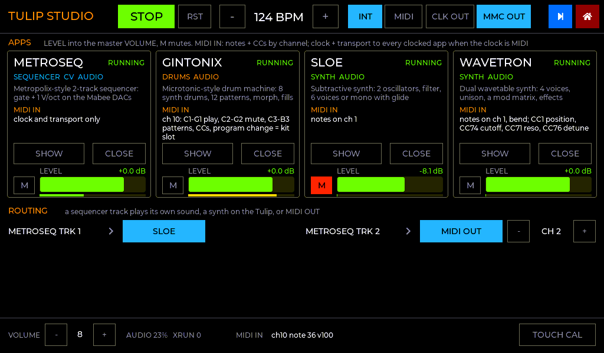
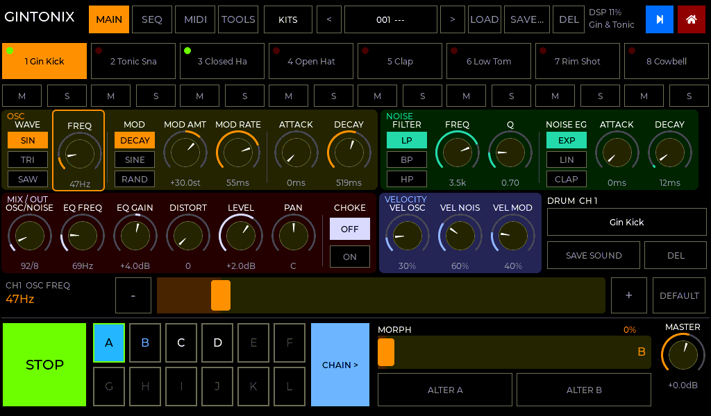
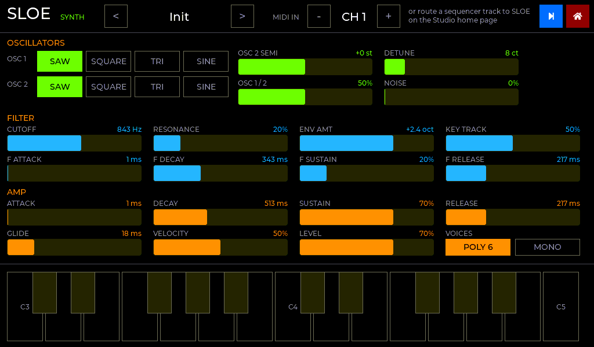

# Tulip CC in C: launcher, Studio, metroseq, GinTonix, Wavetron

Native ESP32-S3 firmware for the [Tulip Creative Computer](https://github.com/shorepine/tulipcc),
with no MicroPython or AMY:

* **[The launcher](docs/LAUNCHER.md)**: a minimal dark home screen.
  * Launch C apps from tiles or a file browser; make folders, rename and delete.
  * Join Wi-Fi, then move apps and files from **any browser** (`http://tulip.local`) or
    a terminal (`tools/tulip.py`).
  * Settings, touch calibration, and a **debug REPL** (on screen and over USB serial).
* **[Studio](docs/STUDIO.md)**: several apps running **at the same time on one clock**.
  * Switch between them with the blue square, as on the original Tulip.
  * Tags: metroseq (SEQUENCER, CV), GinTonix (DRUMS), Sloe and Wavetron (SYNTH).
  * One tempo and transport, MIDI clock / Start / Stop for all of them.
  * A mixer on the Studio home page: a level, mute and peak meter per app.
  * metroseq's tracks can play Sloe or Wavetron on the Tulip, or go out of MIDI OUT.
* **metroseq**: a port of [`reference/metropolix_tulip.py`](reference/metropolix_tulip.py).
  It is a Metropolix-style two-track CV sequencer driving Makerfabs Mabee (GP8413) DACs,
  with rock-solid timing. Design and verification are in
  **[docs/INVESTIGATION.md](docs/INVESTIGATION.md)**.
* **[GinTonix](docs/GINTONIX.md)**: a port of
  [`reference/gintonix/gintonix.py`](reference/gintonix/gintonix.py), the
  Microtonic-style drum machine.
  * 8 synth drums, 12 patterns, morph, fills, the kit bank.
  * Native DSP, sample-accurate on the master clock.
  * Your Python kit and bank files load as they are.
* **Sloe**: a small subtractive synth, the destination for routed sequencer tracks.
  It is a page inside Studio, and also an app on its own, played from MIDI IN.
* **[Wavetron](docs/WAVETRON.md)**: a port of the AMYboard sketch `wavetron_v1_2.py`, a
  dual wavetable synth.
  * 4 voices (MONO / UNISON / POLY), a 4 x 11 mod matrix with audio-rate FM, a filter and
    effects.
  * The 3-D wavetable waterfall, and your own WAV wavetables from `/files`.
  * The sketch's patch files load as they are.
* **hello**: the smallest standalone app, as a template.

| Studio home | GinTonix |
|---|---|
|  |  |
| **Wavetron** | **Sloe** |
|  |  |
| **metroseq** | **Launcher** |
|  |  |

*(Device screens are rendered from the real UI code by `tools/ui_preview`.)*

## Layout

```
launcher/              the launcher (factory app): UI, file browser, Wi-Fi, web server, REPL
  main/web/            the web app (one self-contained HTML file)
apps/studio/           metroseq + GinTonix + Sloe + Wavetron together, on one clock
apps/metroseq/         metroseq on its own
apps/gintonix/         GinTonix on its own
apps/sloe/             Sloe on its own (a synth played from MIDI IN)
apps/wavetron/         Wavetron on its own
apps/hello/            minimal standalone app template
modules/               the Studio apps (each an ESP-IDF component)
  mod_metroseq/        the CV sequencer: engine/ (host-tested), platform/, ui/
  mod_gintonix/        the drum machine: core/ (host-tested), ui/
  mod_sloe/            the synth
  mod_wavetron/        the wavetable synth: core/ (host-tested), ui/
components/
  tulip_studio/        the Studio runtime: master clock, real-time task, MIDI in/out,
                       audio mixer, routing, the squares and the home page
  tulip_hal/           shared by every app: panel + LVGL, touch + calibration, I2C,
                       /files, settings, app lifecycle; partition table + base sdkconfig
  lvgl/                LVGL v9.2.2 (git submodule)
  mdns/                vendored from espressif/esp-protocols (tulip.local)
tools/tulip.py         push/pull/launch over Wi-Fi (Python standard library only)
tools/make_full_image.sh   build everything into tulip-full.bin
tools/gen_gx_factory.py    GinTonix factory kits -> C (from gintonic_presets.py)
tools/ui_preview/      render the on-device UIs to PNGs on a PC
tests/                 host tests and parity checks against the Python originals
reference/             the original MicroPython sketches (metroseq, GinTonix, Wavetron)
```

## Flash it

**First time:** flash the full image over USB. It holds the launcher with **studio**, **sloe**,
**metroseq** and **gintonix** preloaded (Wavetron is inside studio; `wavetron.bin`, Wavetron
on its own, goes on afterwards from the launcher's WI-FI page):

```sh
pip install esptool
esptool.py --chip esp32s3 write_flash 0x0 tulip-full.bin    # top (UART) USB port
```

This replaces the Tulip firmware **and the area where Tulip keeps `/user`**, so back
your files up first. To go back, flash a [Tulip release](https://github.com/shorepine/tulipcc/releases)
the same way.

**After that:** put apps on over Wi-Fi from the launcher's WI-FI page. See
[docs/LAUNCHER.md](docs/LAUNCHER.md). To use your GinTonix banks and kits, copy your
Tulip's `/user/gintonix` folder to `/files/gintonix`.

## Build it

You need [ESP-IDF v5.3.x](https://docs.espressif.com/projects/esp-idf/en/v5.3.2/esp32s3/get-started/).

```sh
git clone --recursive <this repo>        # or: git submodule update --init
. $IDF_PATH/export.sh
tools/make_full_image.sh                 # -> tulip-full.bin (launcher + 4 apps) + wavetron.bin

# develop an app:
cd apps/studio && idf.py set-target esp32s3 && idf.py build
../../tools/tulip.py --pin <PIN> push build/studio.bin --launch
```

**Apps are plain ESP-IDF `.bin` images** built on `components/tulip_hal/sdkconfig.tulip`.
The launcher reads each app's name and version from the image itself. The reasons,
and the rules an app must follow, are in [docs/LAUNCHER.md](docs/LAUNCHER.md#2-packaging-apps-recommendation).
A Studio image combines **modules**; how to write one is in
[docs/STUDIO.md](docs/STUDIO.md#5-writing-a-module). Don't `idf.py flash` an app,
because that overwrites the launcher; push it instead.

## metroseq options (`idf.py menuconfig` → Metroseq)

| Option | Default | |
|---|---|---|
| `METRO_DAC_I2C_HZ` | 400000 | DAC write speed. Lower to 100000 if the timing panel shows I2C errors |
| `METRO_TOUCH_I2C_HZ` | 100000 | GT911 speed (Tulip's value) |
| `METRO_CV_SET_RANGE_10V` | y | Force each GP8413 into its 0–10 V range at boot |
| `METRO_DEFER_FLASH_WHILE_PLAYING` | y | Preset/project flash commits wait for STOP |
| `METRO_TIMING_PROBE_GPIO` | -1 | Mirror TRK1 gate timing onto a pin for a scope (GPIO11 is MIDI OUT now: pick a free pin) |

**CV wiring:**
* **TRK 1:** Mabee at 0x59. VOUT0 = gate (0/5 V), VOUT1 = pitch, 1 V/oct over the full
  0–10 V (C0 = 0 V, C10 = 10 V).
* **TRK 2:** optional second Mabee with its A0 link cut (0x58).
* **MERGE T2>T1:** both tracks share 0x59, with TRK 1 taking priority.
* **MIDI:**
  * **IN** (GPIO12): clock, transport and MMC go to every app when the clock is MIDI
    (Studio home, or metroseq SET → `CLOCK: MIDI`); notes and CCs go by channel.
  * **OUT** (GPIO11): clock out, GinTonix pattern out, routed tracks.
* **Calibration:** measure VOUT1 at two notes and edit `CAL[]` in
  `modules/mod_metroseq/platform/cv_dac.c`.
* **Power:** if the Tulip browns out at power-on with a DAC attached, power the DAC from
  its own 5 V supply with a shared ground.

## Tests (no hardware needed)

```sh
make -C tests test            # master clock, MIDI, metroseq engine (+ Python parity), GinTonix
                              # (player vs the Python, voices, files), Sloe, touch cal, launcher
python3 tests/test_web.py     # tulip.py + the web app in headless Chromium vs a mock device
make -C tools/ui_preview      # render every screen (needs Pillow)
python3 tests/web_mock.py     # run the web app locally against a mock device
```
