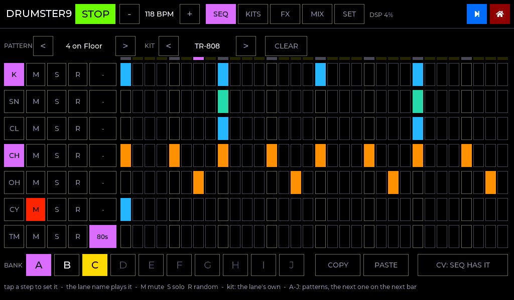
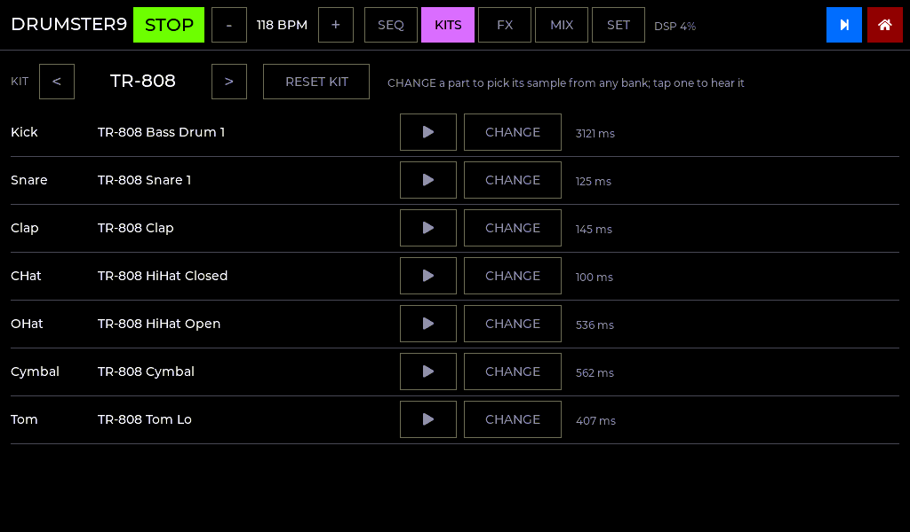
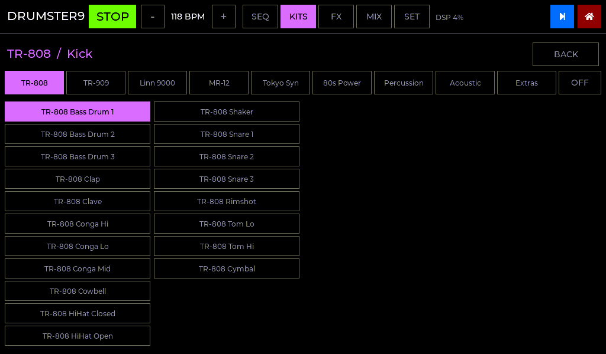
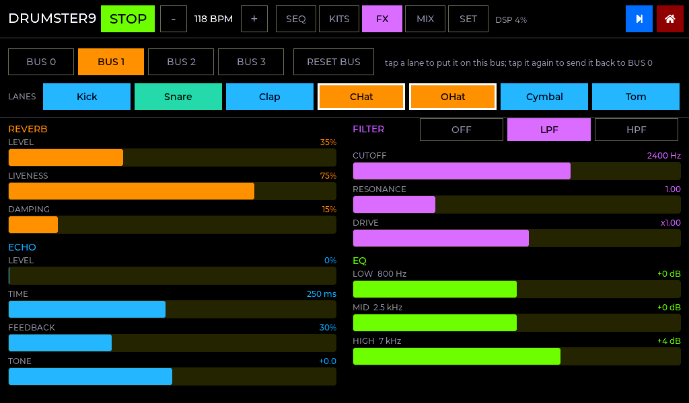
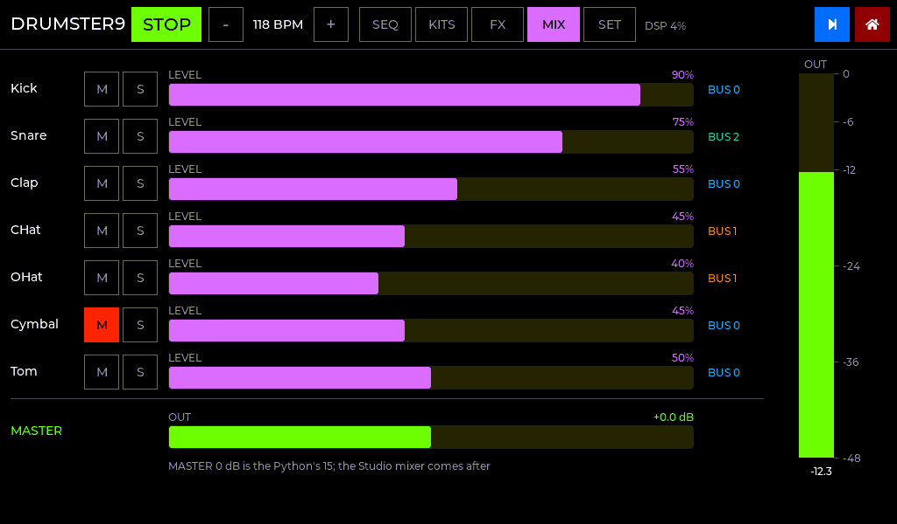
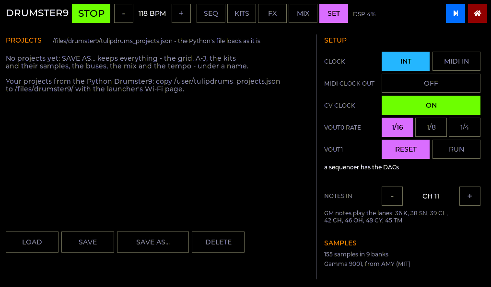

# Drumster9 in C

A native port of the Python sketch `reference/drumster9/drumster9v6.py`, the 32-step drum
machine for the original Tulip, with the **Gamma 9001 samples** built in. It's a Studio
app (role: **DRUMS**), so it runs in two ways:

* **STUDIO:** alongside the other apps, on one clock.
* **DRUMSTER9:** on its own, from its tile on the launcher's start page.

Either way it sends a **CV clock** on the Mabee DAC, as the sketch did (in the Studio,
unless metroseq has the DACs).

| SEQ | KITS |
|---|---|
|  |  |
| **A sample, from any bank** | **FX: the 4 buses** |
|  |  |
| **MIX** | **SET** |
|  |  |

*(Rendered from the real UI code by `tools/ui_preview`.)*

## The pages

| Page | What's on it |
|---|---|
| **SEQ** | 7 lanes (Kick, Snare, Clap, CHat, OHat, Cymbal, Tom) x 32 steps of 1/32 notes - one bar - with the playhead above. Each lane: its name (a pad: tap it to play the lane, it lights when the lane hits), **M**ute, **S**olo, **R**andom (the sketch's Euclidean fills, shaped per drum), and its own **kit**. A step lights in the colour of the bus its lane plays through. Above: the 8 pattern presets, the kit, CLEAR. Below: the **A-J** pattern slots, COPY, PASTE |
| **KITS** | For each kit, the sample each part plays. **CHANGE** opens all 9 banks (the sketch offered the kit's own bank, Acoustic and Extras): tap a sample to hear it and put it in the kit. **RESET KIT** puts the kit's own samples back |
| **FX** | The 4 buses. Tap a lane to put it on the bus you're looking at, tap again to send it back to BUS 0. Per bus: reverb (level, liveness, damping), echo (level, time, feedback, tone), filter (OFF / LPF / HPF, cutoff, resonance), drive, and a 3-band EQ |
| **MIX** | Every lane's level, mute and solo side by side, the master, and a peak meter |
| **SET** | Projects (load, save, save as, delete), the clock (Studio's INT / MIDI), the MIDI channel, the CV clock, and the sample status |

**A-J** work as in the sketch: the lit slot keeps every change. Tap another and it comes
in on the **next downbeat**, with its kit, blinking until then (at once while stopped).
Tap it again to stay where you are.

## The samples

All 155 Gamma 9001 samples from [AMY](https://github.com/shorepine/amy/tree/main/sounds/gamma9001)
(MIT) are in the image, untouched: 16-bit, 22,050 Hz, mono, 4.1 MB. They have their own
4 MB flash partition (`samples`, written by `tools/make_full_image.sh`; see
[LAUNCHER.md](LAUNCHER.md)), and keep AMY's preset numbers, so the sketch's kits,
patterns and projects name them the same way:

| Bank | Presets | | Bank | Presets |
|---|---|---|---|---|
| TR-808 | 0-18 | | 80s Power | 311-330 |
| TR-909 | 256-272 | | Percussion | 331-374 |
| Linn 9000 | 273-282 | | Acoustic | 375-377 |
| MR-12 | 283-286 | | Extras | 378-391 |
| Tokyo Synthetics | 287-310 | | | |

A kit's samples are read into PSRAM when they're first needed (each kit is 45-380 KB).
A sample no kit uses any more is let go when the cache passes 2 MB, and only once it
hasn't played for longer than the longest sample lasts.

## Your files

Projects are the sketch's own file: copy `/user/tulipdrums_projects.json` from the old
Tulip to **`/files/drumster9/tulipdrums_projects.json`** (the launcher's Wi-Fi page)
and they load: the grid, the A-J bank, the kit and every lane's own kit and bus, the
buses' FX, the levels, the master and the KITS page's samples. Up to 16 projects (the
sketch kept 8).

What you're doing is kept by itself in `/files/drumster9/state.json` and comes back
next time; settings are in `settings.json`.

## MIDI and CV

* **MIDI IN** (SET page, default channel 11): GM drum notes play the lanes - 36 kick,
  38 snare, 39 clap, 42 closed hat, 46 open hat, 49 cymbal, 45 tom - with velocity.
* **Clock:** Drumster9 plays to the master clock: internal, or MIDI clock with Start /
  Stop / Song Position (the sketch's SYNC EXT).
* **MIDI clock out:** on the SET page.
* **CV clock:** the runtime's, which every drum machine gets.
  * **Output:** the Mabee DAC at 0x59, as the sketch drove it. VOUT0 is a square-wave
    clock locked to the step grid (1/16, 1/8 or 1/4). VOUT1 is a one-step reset pulse
    on every downbeat, or high while running.
  * **Soft start:** VOUT0 eases up and down once, a second after start-up.
  * **When:** on its own, and in the Studio unless metroseq (whose gate and pitch use
    the DACs) is on too.
  * **Where to set it:** the SET page, the CV button on the SEQ page, or the Studio
    home page.

## What's different from the sketch, and why

| | Sketch (AMY) | C |
|---|---|---|
| **Timing** | AMY's sequencer fired the hits; a Python callback drove the LEDs and CV clock | Every hit is worked out per audio block from the master clock and lands on its exact sample. The CV clock runs in the real-time task |
| **Retriggers** | Pre-hit note-offs to dodge an AMY PCM bug (and they could click) | The old hit fades out over 1.5 ms under the new one: no bug to dodge, no click |
| **Tags, rebuilds, coalescing, quiescing flash** | Workarounds for AMY's sequencer and the MicroPython task | Not needed: nothing is scheduled ahead, and the samples are in PSRAM, so saving never touches what's playing |
| **Tempo per pattern** | A bank slot stored and set the tempo | The tempo is the Studio's: switching pattern never jumps it. A project still sets it |
| **PLAY / STOP** | Queued to the top of the bar | The Studio transport: PLAY starts every app on the same downbeat |
| **RESTART** | Rebuilt AMY | Not needed |
| **KITS page** | The kit's own bank, Acoustic, Extras | All nine banks |
| **New** | | MIDI notes play the lanes; the lane pads; the session is kept by itself; Studio patches |

The FX follow AMY's: the EQ is a low shelf at 800 Hz, a peak at 2.5 kHz and a high shelf
at 7 kHz (AMY's bands), and the echo's tone darkens the repeats above 0 and thins them
below. The reverb is a 4-line feedback delay network rather than AMY's own. MASTER 0 dB
is the sketch's 15.

## Verification (`make -C tests test`)

* **Samples:** the packed image has 155 samples in 9 banks at the sketch's preset
  numbers and names, and every kit's samples are there; a damaged image is refused.
* **Model:** the 8 presets as the sketch has them; Euclidean fills on each drum's grid;
  A-J slot switching; mute and solo.
* **Player:** 1/32 steps exactly on the grid; a queued slot switches on the next
  downbeat and that downbeat plays it; a muted lane doesn't hit; starting mid-bar (Song
  Position) keeps the steps in their place.
* **Sound:** a hit starts on its frame and is the sample at 2x; nothing with the gate
  shut; a retrigger mid-sample doesn't click; LPF and HPF; the echo lands 250 ms after
  the hit; the reverb has a tail; the EQ boosts and cuts; everything at once settles;
  an idle bus stops costing anything. Four busy buses take about 5% of real time on a
  PC.
* **Projects:** a project as the sketch wrote it loads (lanes, buses, A-J, kit samples);
  round trip; junk is refused field by field.

**Needs a Tulip:** listening (levels against the AMY version), the CV clock on a DAC,
and the DSP load next to the other four apps (the header shows Drumster9's).
