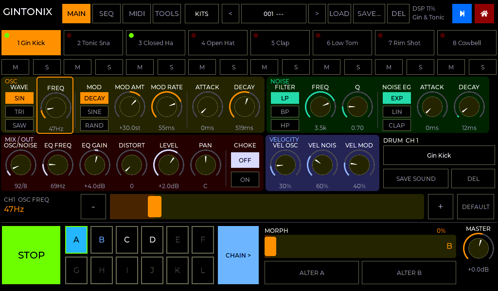
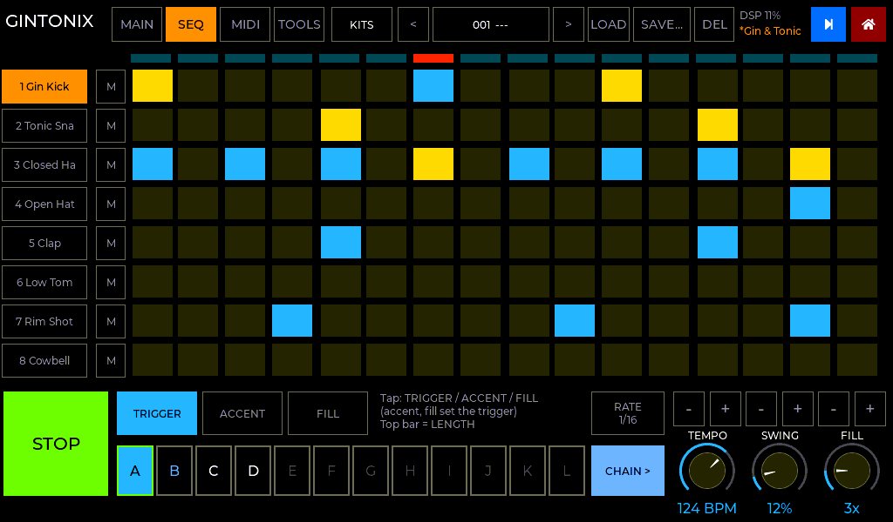
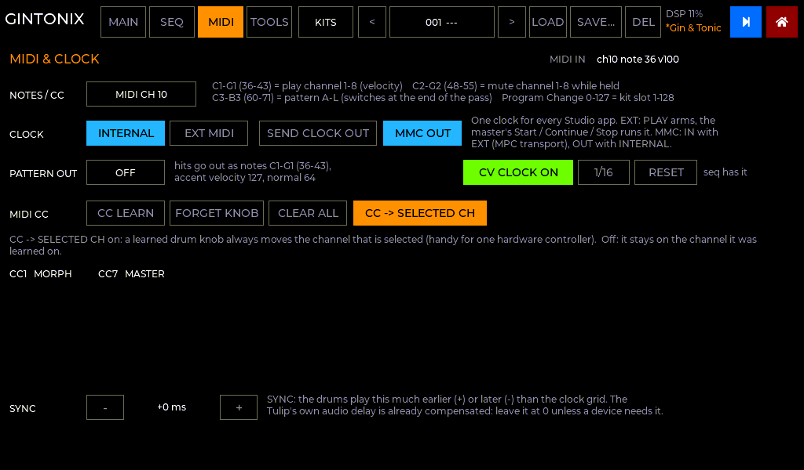
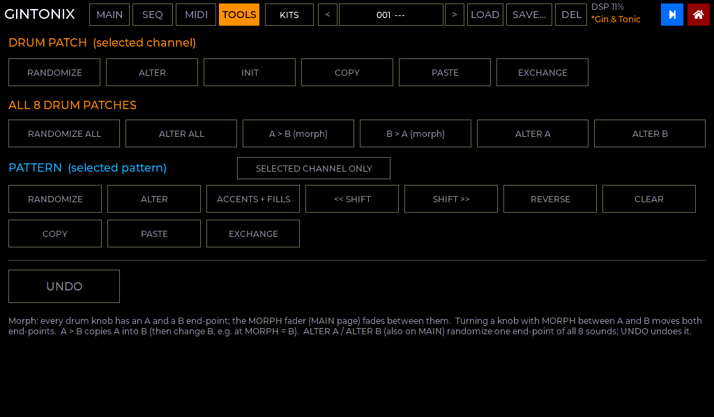

# GinTonix in C

A native port of `reference/gintonix/gintonix.py`, the Microtonic-style drum machine
for the Tulip, as a Studio app. It runs with no MicroPython or AMY. It's in the
launcher two ways:

* **gintonix:** on its own;
* **studio:** together with metroseq and Sloe, on one clock ([STUDIO.md](STUDIO.md)).

| MAIN | SEQ |
|---|---|
|  |  |
| **MIDI** | **TOOLS** |
|  |  |

*(Rendered from the real UI code by `tools/ui_preview`.)*

## Same as the Python

* **Header:**
  * pages MAIN / SEQ / MIDI / TOOLS;
  * **KITS** (the factory kits plus `kits/*.json`);
  * the 128-slot kit bank with `<` `>`, LOAD, SAVE… (slot + name, keyboard) and DEL
    (tap twice);
  * the kit name, with `*` when it has been edited.
* **MAIN:**
  * the 8 channel pads: tap to select, tap the selected one to hear it;
  * M / S on each channel;
  * the selected channel's drum patch, in tinted OSC / NOISE / MIX / VELOCITY panels.
    Pots are dragged up and down; switches are latching buttons;
  * the drum sound library: pick a sound, SAVE SOUND, DEL;
  * the focus fader for the last pot touched: a wide fader, `-` / `+` fine steps (hold
    to repeat) and DEFAULT;
  * PLAY, patterns A–L, CHAIN >;
  * the MORPH fader, ALTER A / ALTER B and MASTER.
* **SEQ:**
  * 8 × 16 steps, set in TRIGGER / ACCENT / FILL mode;
  * the top bar sets the pattern length, with the playing step lit;
  * patterns, RATE (1/8, 1/8T, 1/16, 1/16T, 1/32);
  * TEMPO, SWING and FILL rate (2–8 hits), each with `-` / `+`.
* **MIDI:**
  * the note / CC channel;
  * the note map: C1–G1 play, C2–G2 mute while held, C3–B3 pick a pattern, and
    Program Change loads a kit slot;
  * the clock (INTERNAL / EXT MIDI / SEND CLOCK OUT / MMC);
  * PATTERN OUT, which sends the hits as notes C1–G1 (accent 127, normal 64);
  * CC LEARN / FORGET KNOB / CLEAR ALL / CC → SELECTED CH;
  * the CC list and the MIDI IN monitor.
* **TOOLS:**
  * for the drum patch: randomize, alter, init, copy, paste, exchange;
  * for all 8 patches: randomize, alter, A > B, B > A, ALTER A / B;
  * for patterns: randomize, alter, accents + fills, shift, reverse, clear, copy,
    paste, exchange, with "selected channel only";
  * UNDO.
* **The engine:**
  * morph between each channel's A and B patches;
  * choke (hi-hats);
  * accents, and fills with fading flams;
  * swing, including odd lengths;
  * chains and queued pattern changes at the end of the pass;
  * passes anchored to song position 0.

## Your files work as they are

The formats are the Python version's. Copy your Tulip's `/user/gintonix` folder to
`/files/gintonix` with the launcher's web page (`http://tulip.local`) and everything
loads:

| File | What |
|---|---|
| `gintonic_bank/001.json` … `128.json` | your kit bank, `{"name", "state"}` |
| `kits/*.json` | converted Microtonic kits, in either form (`{"state": …}` or the raw conversion) |
| `gintonix_drums.json` | your saved drum sounds |
| `gintonic_settings.json` | MIDI channel, CC map, last slot, pattern out |

The kits are also looked for in `/files/gintonic/kits`, as the Python did.

**Saving projects.** **SAVE...** in the header saves the whole project (the 8 sounds, A
and B for morph, and the 12 patterns with their chains, accents and fills) to a bank slot,
`gintonic_bank/NNN.json`. Before this update the apps' `/files` only knew 8.3 file names,
so `gintonic_bank` and `gintonic_settings.json` couldn't be created and saves failed. They
work now. A Studio patch also carries the current kit and patterns.

## What's different, and why

| | Python (AMY) | C |
|---|---|---|
| Sound | 6 AMY oscillators per channel. EQ approximated with HP/LP/notch filters, sine FM above 60 Hz, and random modulation sample-and-held by Python | Native per-sample DSP (`core/gx_dsp.c`): band-limited oscillators, exponential pitch modulation at any rate, a real peaking EQ, a trapezoidal SVF and tanh distortion |
| Pattern timing | One pass loaded into AMY's sequencer and patched as you edit. Swing and flams rounded to 1/48 beat (10 ms at 120 BPM) | Each audio block computes its own hits from the master clock's timeline (`core/gx_seq.c`). Exact flams and swing, each hit on its own sample, on the same grid as metroseq |
| CPU SAVER / ECO | Needed: AMY could overload | Gone: the native voices have a fixed cost. The header shows the drum machine's DSP load |
| SYNC OFFSET | About 30 ms, making up for AMY's audio delay | That delay is compensated exactly, so SYNC is now a ±50 ms trim (default 0) for external gear. Old `sync_ms` values are ignored on purpose |
| Clock settings | GinTonix's own | The Studio master clock's, shared with every app (they're also on the Studio home page) |
| Default MIDI channel | omni | **10**, so that it can share MIDI IN with a synth on channel 1. Your settings file's channel is used if you copy it |
| MUTE TULIP SYNTHS | Silenced Tulip's own MIDI synths | Not needed: there are none |
| Touch | multi-touch nearest point | single touch (LVGL); same relative drag |
| Kit tempo | Loading a kit sets the tempo, unless on MIDI clock | Same, but it is the **shared** tempo, so metroseq follows it too |

## Verification

All of this runs on the host (`make -C tests test`):

* **The pattern player against the Python's own `layout()`** (run without AMY): random
  patterns with every rate, swing amount, odd lengths, fills of 2–8, accents, choke and
  mutes. **298 of 298 match.** The Python is allowed half a tick of rounding, and its
  hits can merge when a fill is faster than its tick grid. 2 more were skipped: there
  the Python itself drops hits, because it ran out of AMY sequencer tags.
  * This check found a real bug, now fixed: the last flam of a swung pass was dropped.
* **Display text:** all 18 knobs on 400 random patches give the same text as the
  Python's `fmt()` ("632Hz", "+3.0dB", "L30" …).
* **Kits:** all 7 factory kits come out identical to `kit_state()`. The C tables are
  generated from `gintonic_presets.py` by `tools/gen_gx_factory.py`.
* **Microtonic kit conversion:** 60 random kits are identical to `mt_kit_state()`,
  including missing and null fields.
* **Voices (all 39 factory drums):**
  * finite, in level, and finished within their decay;
  * the 808 kick sits around 100 Hz and the closed hat above 3 kHz;
  * velocity sensitivity works;
  * choke cuts the open hat within 5 ms.
* **Transport:**
  * chains;
  * a queued pattern switches at the end of the pass;
  * Song Position + Continue lands exactly on its 1/16;
  * mutes take effect on the next step;
  * stop / restart.
* **Sample accuracy:** at 133 BPM, every hit is within 1 frame (23 µs) of its exact
  time.
* **Files:**
  * a bank slot round trip;
  * the sketch's own `gintonix_drums.json` loads.

`tests/gx_tool render N bars out.wav` renders a factory kit to a WAV on your computer,
through the same code the Tulip runs.

**Needs a Tulip:**

* listening;
* levels against the Python version (`OUT_TRIM` in `gx_dsp.c`);
* the real DSP load with long tails and distortion on all 8 channels.
