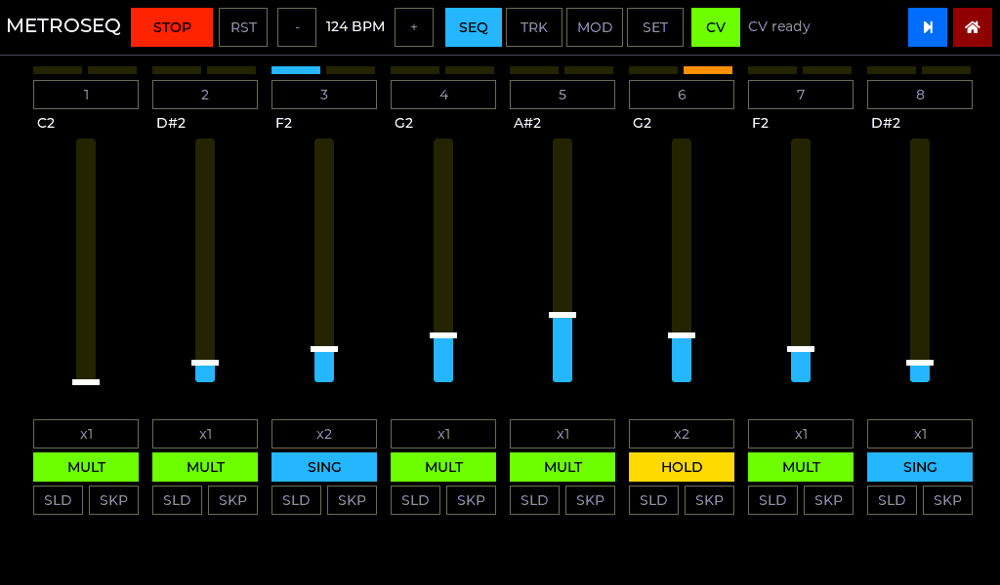
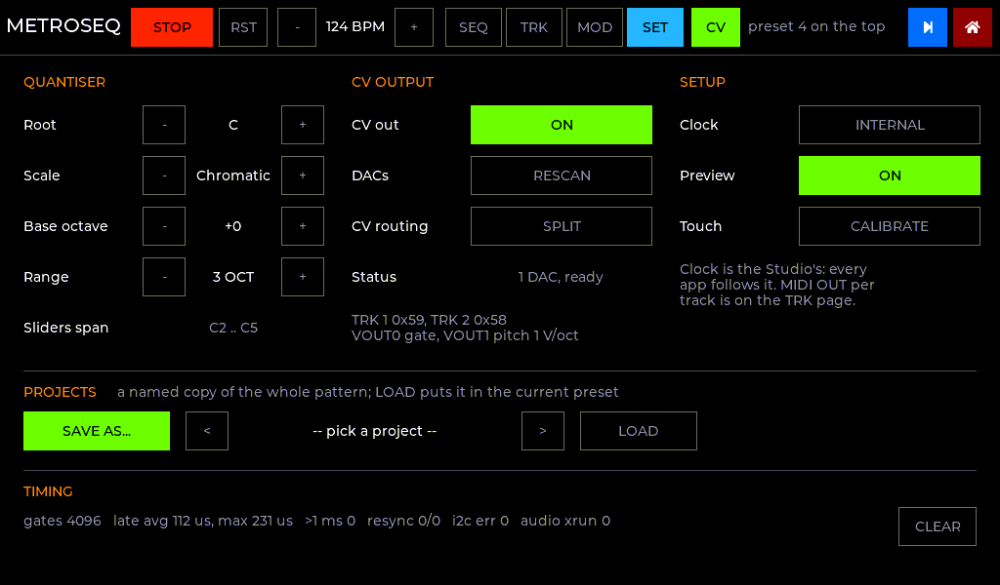
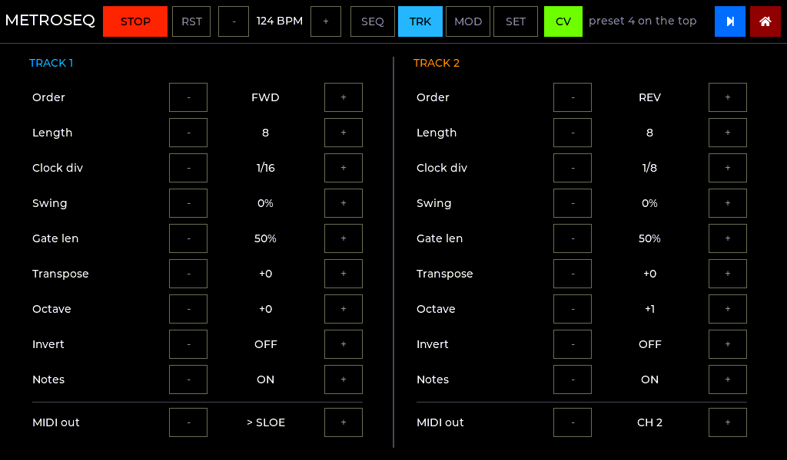
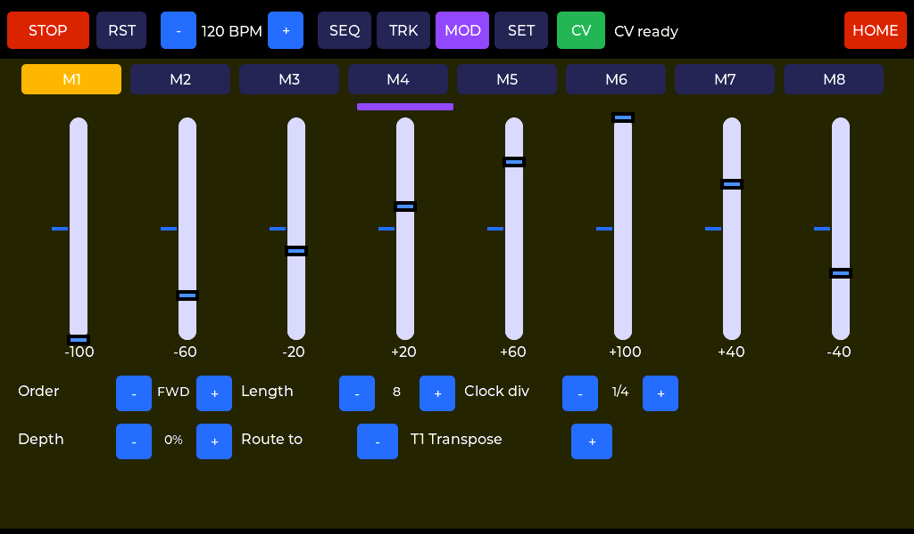

# Native C on the Tulip CC: investigation and design

The question was whether `metropolix_tulip.py` (a Metropolix-style CV sequencer
written for the Tulip CC's MicroPython/AMY firmware) can become bare C firmware
that runs on the Tulip hardware with no Tulip/AMY firmware. The goals: the same
UI and functionality, CV gate and pitch through the Mabee DAC(s), and, above
all, **stable timing with no stalls or halts in the sequence**.

**Short answer: yes.** This repo contains a working port. The engine is tested on
the host against the original Python, and the firmware builds for ESP-IDF 5.3
with zero warnings. It has **not been run on a Tulip yet**: see
[What still needs hardware](#what-still-needs-hardware).

---

## 1. Why the Python version can stall

All of these come from reading the sketch and Tulip's firmware source
(`shorepine/tulipcc`):

| Mechanism | Where | Effect on the sequence |
|---|---|---|
| The AMY sequencer hook queues the Python clock callback with `mp_sched_schedule` (`tulip/shared/tsequencer.c:33`). It runs on the **one MicroPython thread**, between bytecodes. | `_master_tick` | Any long Python work (a page `refresh()`, a JSON save, a big LVGL redraw) delays the clock. The sketch's own `MAX_CATCHUP` resync exists for this reason. |
| LVGL's `lv_task_handler` is queued onto the **same** thread (`modtulip.c:1243`). | every redraw | A redraw and a step can't run at the same time; a slow redraw pushes the step back. |
| Gate-offs, swing, ratchets and glides all use `tulip.defer(ms)`, with **1 ms resolution**, dispatched from that same thread. | `_cv_raise`, `_fire_pulse`, `cv_set_pitch` | Jitter is roughly whatever else the interpreter is doing at that moment. Glides are 8 coarse steps. |
| Python allocation in the hot path (closures for every defer, dict lookups, `%` formatting) | everywhere | Causes garbage-collector pauses, which stop the thread outright. |
| CV writes go through `machine.I2C` at 100 kHz, on the bus that Tulip's touch task polls with its own driver. | `_Mabee.write` | A 3-byte write takes about 0.4 ms of wire time plus interpreter overhead, and can queue behind a touch read. |
| Preset/project saves write FAT files in flash. | `_write_presets` | A flash erase can freeze both cores for tens of ms unless code runs from PSRAM. |

None of these is a bug in the sketch. They come from running a real-time job in an
interpreter that shares one thread with the UI. A native port can remove every
one of them.

## 2. The hardware (from the Tulip source, not guessed)

Taken from `tulip/esp32s3/pins.h` (MAKERFABS + TULIP4_R11), `boards/N32R8`,
`esp32s3_display.c` and `gt911_touchscreen.c`. All of it is in
`components/tulip_hal/include/tulip/board.h`.

* **MCU:** ESP32-S3 at 240 MHz, two cores, 32 MB octal flash, 8 MB octal PSRAM.
* **Display:** 1024×600 RGB panel. It is wired for **8-bit RGB332** (B6 B7 G5 G6 G7 R5 R6
  R7), pclk 28 MHz, and the backlight PWM on GPIO47 is inverted.
* **Touch:** GT911 at 0x5D or 0x14, reset on GPIO48 (it has to be toggled twice on R11).
  Tulip's calibration is x−2, (y−12)·0.8.
* **I2C:** SDA 17 / SCL 18, with external pull-ups. **The Mabee DAC(s) share this bus with the
  touch controller.** That is the most important hardware fact for timing.
* **Mabee DAC (GP8413):** 0x59 drives TRK1 and 0x58 (A0 link cut) drives TRK2. Register 0x02 is
  VOUT0 (gate) and 0x04 is VOUT1 (pitch). Values are 16-bit little endian with 15
  significant bits, and range register 0x01 = 0x11 selects 0–10 V. Tulip's own `mabeedac.py` drives this bus at
  400 kHz.
* **Audio:** I2S on LRCLK 2, BCLK 8, DOUT 5. That is enough to rebuild the audio preview without AMY.

## 3. Design for solid timing

```
 core 1 (nothing else pinned here)          core 0
 ┌───────────────────────────────┐   ┌──────────────────────────────────┐
 │ seq task  prio 23             │   │ RGB panel bounce-buffer ISR      │
 │  GPTimer alarm ─► notify      │   │ lvgl task  prio 4  (UI, flush)   │
 │  spin last 40 µs to deadline  │   │ audio task prio 6  (I2S preview) │
 │  engine.advance(now)          │   │ store task prio 2  (NVS commits) │
 │  I2C: DAC writes at deadline  │   └──────────────────────────────────┘
 │       touch reads only in gaps│        ▲ touch events (queue)
 └──────────────┬────────────────┘        │ g_status (playheads, stats)
                └─ seq_cmd() queue ◄──────┘ UI commands (non-blocking)
```

### 3.1 One clock, absolute time
The engine (`engine/seq_engine.c`) never says "N ms from now". Every event has an
**absolute timestamp in µs** on a free-running 1 MHz GPTimer. Master pulse *n* is
computed as `anchor + n·15 000 000 / bpm`, a product rather than a running sum, so
**it cannot drift**. The host test confirms zero µs grid error after one simulated hour at 133 BPM.
A tempo change re-anchors at the last pulse, so the grid continues without a jump.

### 3.2 A dedicated core and a precise wake
The sequencer task is pinned to core 1 at priority 23, and nothing else is pinned
there. It sleeps on a GPTimer alarm (IRAM-safe ISR → task notify) set 40 µs
before the next event, then spins on the counter to the exact deadline.
Interrupt and context-switch latency (a few µs) is absorbed by the spin instead
of turning into gate jitter.

### 3.3 The shared I2C bus is scheduled, not contended
The sequencer task is the **only** user of the bus. CV writes go out at their
deadline. A touch read (worst case ~4 ms at 100 kHz, ~1 ms at 400 kHz) starts only
when the gap to the next event is longer than that worst case. Otherwise it is
deferred until just after the event. A touch read can therefore **never** sit on the bus when a gate is
due. Touch events go to LVGL through a queue, so a quick tap is never lost
while the UI is busy.

Latency budget per write, at the defaults (DAC 400 kHz, touch 100 kHz):

| Write | Time | Notes |
|---|---|---|
| One gate or pitch write (3 bytes) | ~0.1 ms wire + ~0.03 ms driver | ~0.4 ms at 100 kHz |
| Note-on (pitch, then gate) | gate edge ~0.25 ms after nominal | **Constant**, so it is latency, not jitter. Pitch always settles before the gate rises. |
| Both tracks change note on the same 1/16 | TRK2 gate edge ~0.5 ms after nominal | Fixed order every time |

Repeated identical pitch writes are skipped (no bus time when nothing changes).

### 3.4 Lock-free hand-off between UI and engine
* The UI edits the pattern with single-field writes, which are atomic on Xtensa. Whole-pattern
  swaps (preset load, paste) use a spinlock that the engine holds only
  while it *computes* a batch (microseconds), never during I2C.
* The engine emits a list of actions, releases the lock, then the task executes the
  I/O. **The UI never waits on the sequencer, and the sequencer never waits on the UI.**
  Playhead LEDs are drawn by the UI polling published state, so a slow redraw
  delays an LED, never a gate.

### 3.5 Flash writes can't freeze the CPU
* `CONFIG_SPIRAM_XIP_FROM_PSRAM=y`: code and rodata run from PSRAM, so the IDF docs say
  flash erase/program **does not disable the caches**, and both cores keep running.
* As a second layer, `CONFIG_METRO_DEFER_FLASH_WHILE_PLAYING` (default on) commits
  a save to NVS only after STOP. The RAM bank updates immediately, so a saved
  preset can be loaded at once.
* Presets are versioned binary NVS blobs, which are power-fail safe and wear levelled. They are
  sanitised on load, so a corrupt blob can't push the engine out of range.

### 3.6 Graceful behaviour when something does go wrong
* **Stall resync** (same policy as the Python `MAX_CATCHUP`): more than 2 pulses behind means
  re-anchor and drop the backlog, with no flam.
* Swung or ratcheted gate-ons that come due >20 ms late are **dropped**. Gate-offs always run,
  so nothing is left stuck high.
* A glide that falls behind jumps to its present value instead of replaying missed steps.
* The engine stops a batch with headroom left and finishes it on the next pass, so actions
  can't be lost.
* A DAC that fails 5 times in a row is dropped with a header message (as in the Python), and
  the other track is unaffected.

### 3.7 Deliberate behaviour changes vs the Python
Each one removes a way the original could glitch. All are marked `FIX:` in the code.

1. **Minimum 1 ms gate low before a retrigger.** At 100% gate the Python retriggered with ~0 ms
   low time, which many modules miss.
2. **HOLD release is keyed on "a hold is open", not on the stage's *current* mode.** Editing a
   HOLD stage mid-hold could leave the gate stuck high.
3. **Swing uses the track's own pulse parity.** The Python used master-1/16 parity, so a track on
   /8 or slower (always on even pulses) could never swing. /16 tracks behave identically.
4. **STOP and reload flush every queued event**, so no swung hit fires after STOP and no HOLD
   survives a preset load.
5. **Glides are a smooth 500 Hz ramp** instead of 8 steps.

### 3.8 Display
The esp_lcd RGB driver scans an 8-bit framebuffer in PSRAM through two internal-RAM
bounce buffers (12 rows each, the same as Tulip). LVGL 9.2 renders RGB565 into an 80 KB
internal band buffer, and the flush packs it to RGB332. UI colours are defined as
the sketch's exact RGB332 values, so the screen matches what the Python app
showed. The bounce ISR and all rendering stay on core 0.

## 4. Feature parity

Everything in the sketch is ported:

* **SEQ:** 8 stages with pitch slider, note name, pulse count, gate type, SLD, SKP, two
  playhead LEDs, and a stage-detail popup (ratchet, probability, accumulate).
* **TRK:** order (FWD/REV/PEND/RAND/BRWN), length, clock div, swing, gate length, transpose,
  octave, invert, and audio mute per track.
* **MOD:** 8 lanes with bipolar sliders, order, length, div, depth, and 13 routing destinations.
* **SET:** root, scale (11 scales), base octave, CV on/off, rescan, MERGE T2>T1 with TRK1 priority,
  audio-preview toggle, and named projects with the on-screen keyboard. (The presets, with
  copy/paste, are now on the SEQ page: see section 9.)
* **Audio preview** without AMY: two saw voices with the same envelope and filter settings, on I2S.
* **New:** a timing panel on SET showing live gate lateness (avg/max/histogram), resyncs, late-drops,
  I2C errors and deferred touch reads, with a CLR button.

## 5. What was verified (without hardware)

| Check | How | Result |
|---|---|---|
| Engine matches the original | `tests/py_parity.py` runs **the original Python engine** (stubbed Tulip/AMY, virtual clock) and the C engine on 6 patterns: default, ratchet + swing + SING, pendulum/skip/accum/quantiser, merge priority, 3 routed mod lanes, slide + 173 BPM + dotted divs | Every gate edge matches in time (±1 ms, the Python's defer resolution) and pitch. The test is shown to fail when a difference is injected. |
| No drift | 1 h at 133 BPM | 0 µs grid error |
| Timing invariants | `tests/test_engine.c` covers pitch-before-gate, ratchet gaps at 300 BPM, stall resync, small-lateness catch-up, tempo re-anchor, merge priority, HOLD edit, STOP flush, /8 swing and glide | all pass under ASan/UBSan |
| Robustness | fuzz: 300 × 20 s random patterns with random live edits, commands and stalls | 0 queue overflows, 0 dropped actions, output always in time order |
| Firmware | `idf.py build` (ESP-IDF 5.3.2, esp32s3) | 0 warnings; 241 KB internal RAM free statically |
| UI layout | `tools/ui_preview` renders the **real UI code** on the host through the device's RGB565→RGB332 conversion | all pages and popups checked visually |

## 6. What still needs hardware

These can only be confirmed on a Tulip:

1. **Panel bring-up.** The timings and pins are Tulip's, but this uses the driver's own framebuffer and
   bounce path rather than Tulip's custom bounce callback. Expect it to work. If the image is
   shifted or flickers, check `pclk_active_neg` and the porches.
2. **Touch.** Check the reset sequence and calibration on your unit. If 100 kHz is reliable, try
   `METRO_TOUCH_I2C_HZ=400000`.
3. **DAC at 400 kHz** on your cable. Tulip's `mabeedac.py` uses 400 kHz on this bus, but fall back to
   `METRO_DAC_I2C_HZ=100000` if you see I2C errors on the timing panel.
4. **1 V/oct calibration.** Measure C2 and C6 on VOUT1 and enter gain/offset in `cv_dac.c` `CAL[]`.
   The GP8413 is 15-bit (0.3 mV/LSB ≈ 0.4 cent), so calibration, not resolution, sets accuracy.
5. **Timing numbers.** Watch the SET-page timing panel while hammering the UI (drag sliders,
   switch pages, save presets). The target is `>1ms 0`, with max lateness ≲0.6 ms at 400 kHz. The worst case is both tracks changing note on the same pulse, and that worst case is constant.
   For a scope check, set `METRO_TIMING_PROBE_GPIO=11`: the probe edge marks the scheduled
   instant and VOUT0 shows the I2C latency after it.

### Known limits / possible next steps
* A **CV RESCAN while playing** probes the bus synchronously (a few ms at most if a DAC is absent).
  It is user-initiated and rare, but could move into the gap scheduler like touch.
* LVGL draws into the live framebuffer, so minor tearing is possible during big redraws (Tulip has the same
  behaviour). A second PSRAM framebuffer swapped in vsync would remove it.
* Note-on latency could drop to a single write by pre-writing the next stage's pitch
  as soon as the previous gate falls (except for legato).
* The preview synth is intentionally simple. It's for monitoring, not a voice.
* External clock/reset in, MIDI clock and per-stage CV in are not in the sketch and are not added.

---

## 7. Follow-up: touch, MIDI clock, CV range

### 7.1 Touch responsiveness
Before this change, the path from finger to reaction was: GT911 scan (~10 ms) → poll in a
bus gap → queue → the LVGL task sleeping out the rest of its frame (up to 10 ms) →
LVGL's input timer (5 ms) → action on **release**. That is roughly 20–30 ms plus however
long the finger stayed down. Now:

* The touch driver **wakes the LVGL task** as soon as an event is queued, and the loop
  feeds it to LVGL (`lv_indev_read`) before anything else.
* Buttons act on **press**, not release, and show a white rim while held. This UI has no
  scrolling, so nothing can mistake a press for the start of a scroll. Hold-to-repeat
  (the BPM ± buttons) still works.
* Sliders have a **24 px extended hit area** on each side of their 20 px track.

So a press now reacts within one touch poll plus one render, about 10–20 ms. The sequencer
is unaffected: touch reads still only happen in bus gaps.

### 7.2 Touch calibration
* **What's fixed in hardware.** The GT911 reports coordinates in its own configured
  range (registers 0x8048/0x804A, now read and logged at boot). Tulip copes with a fixed
  x−2, (y−12)·0.8 map, and that mismatch is the likely source of "almost but not quite"
  touches near the edges.
* **Method.** A 6-coefficient affine map (offset, scale, rotation and skew per axis) is
  fitted by least squares to **5 targets**: 4 corners inset 64 px, plus the centre (the
  TI SLYT277 approach). Five points over-determine the fit, so one sloppy tap is averaged
  out. The residual error then tells us if the taps were inconsistent; a fit is rejected
  if RMS > 10 px, any target > 25 px, or the map is implausible (mirrored, collapsed).
  Each target averages all the samples of the press, skipping the first contact sample.
* **Can't lock you out.** The prompt and the targets read **raw** coordinates through a
  display hook and offer only half-screen choices, so they work even with a badly wrong
  saved calibration. The result is applied live for testing. SAVE writes it to NVS; CANCEL,
  or 20 s without a touch, restores the previous one.
* **Startup.** Tap the left half to calibrate, the right half or wait 5 s to keep the saved
  (or default) calibration. The countdown only starts once the touch controller is up.
* Tests (`tests/test_midi_touch.c`) check exact recovery of Tulip's map, a skewed panel
  with ±3 px tap noise (within ~2 px), and rejection of a 60 px-off tap and of degenerate
  input.

### 7.3 MIDI clock in
* **Hardware.** Tulip's MIDI IN is UART1 RX on GPIO12, 31250 8N1, not inverted (from AMY's
  `esp_init_midi`). A small task on core 1 asks for **one byte at a time with no
  timeout**, so it wakes as each byte lands. AMY's own loop uses `uart_read_bytes(...,
  1 ms)`, which waits for a full buffer or the timeout and can add up to 1 ms. Each byte
  is timestamped on the sequencer's GPTimer clock. If bytes arrive together, they are
  back-dated 320 µs apart (one byte time at 31250 baud).
* **Hard sync, soft tempo.** Every 6th clock (one 1/16) fires a master pulse **at that
  clock's own timestamp**, so the sequence is phase-locked to the master with no added
  lag or drift. Gate lengths, swing, ratchets and glides use a tempo averaged over the
  last 24 clocks. A jittery clock therefore doesn't make gate lengths jitter. A single
  late clock is ignored, and three in a row are taken as a real tempo change.
* **Transport.** START arms, and the next clock is the downbeat. STOP stops. CONTINUE
  resumes mid-bar at the right phase. Song Position silently fast-forwards the engine so
  the next pulse is the requested 1/16. In MIDI mode, PLAY arms or cancels (`ARMED` on the
  button), and RST re-arms so the restart lands on the next clock. Clock loss (no clock
  for 500 ms) clears the tempo display.
* **Choice of design.** A PLL would smooth a jittery master, but it adds phase lag and lock
  time. Most Eurorack sequencers hard-sync to the incoming clock, and this does too.
* Tests cover a 120 BPM clock with ±0.3 ms jitter: every gate lands exactly on its 6th-clock
  timestamp and the tempo reads 120.0. They also cover STOP/CONTINUE mid-bar, SPP 12, an
  ignored hiccup, a 120→90 tempo change, dropout, and real-time bytes inside notes and
  sysex.

### 7.4 CV range 0–10 V, C0 = 0 V
The DAC already mapped C0 (MIDI 12) to 0 V on its 0–10 V range. But the engine clamped
notes to MIDI 0–120, so anything below C0 piled up on 0 V and the top stopped at C9 (9 V).
Now:

* Notes are **folded by octaves** into C0..C10, the DAC's full 0–10 V. They stay in key and
  never pile up on 0 V or 10 V. The fuzz test asserts every emitted pitch is in range.
* Base octave runs −2..+5. At −2 the lowest slider note is C0 = 0 V, and at +5 the highest
  is C10 = 10 V.
* The GP8413 range register is still forced to 0–10 V at boot (`METRO_CV_SET_RANGE_10V`).

## 8. Follow-up: metroseq inside Tulip Studio

metroseq now runs in the Studio runtime ([STUDIO.md](STUDIO.md)), alone (`metroseq`) or
alongside other apps (`studio`). What changed for its timing:

* **The sequencer task is shared.** It became the Studio `rt` task
  (`components/tulip_studio/src/rt.c`): same core, priority, GPTimer wake-and-spin, and
  I2C ownership with touch in the gaps.
* **One master clock delivers every 1/16.** That covers the internal tempo as well as
  MIDI clock (`tclock.c`, mapped onto the engine by `engine/seq_clock.c`), so metroseq
  and the drum machine share one grid.
  * On 20 random patterns, all 16,821 CV events matched those of the engine's own clock
    to the microsecond (`tests/test_midi_touch.c`).
  * Gate lengths are computed from the exact tempo, not a rounded 1/16.
* **PLAY starts the downbeat 20 ms ahead.** This lets audio apps place it exactly.
  **RST** restarts metroseq's tracks on the next 1/16, in step with everyone else.
* **Core 1 is shared.** The audio task (all apps' sound) sits on core 1 below the `rt`
  and MIDI tasks, so it can never delay a gate. The preview voice is now part of that
  mix.
* **MIDI OUT:** GPIO11 is now MIDI OUT, so pick another pin for the timing probe.

## 9. Follow-up: presets on the SEQ page, RANGE, MIDI out

| SEQ with its presets | SET |
|---|---|
|  |  |
| **TRK, with MIDI out** | **MOD, with MIDI CC out** |
|  |  |

### 9.1 Presets

* **10 presets, under the tracks on the SEQ page.** The lit (orange) number is the one
  playing, and it **keeps every change** - steps, tracks, MOD lanes, quantiser - saved to
  its slot as you go. There's no SAVE button. Numbers holding a pattern are white,
  empty ones dim.
* **Another number comes in at the switch point** (SET → **Preset switch**). It blinks
  yellow until then, and on that 1/16 both tracks start over from their first stage
  with it.
  * **BAR** (the default), **2 BARS**, **4 BARS:** the next bar line of the master
    clock (song position 16, 32 ... or every 32 / 64). That's the downbeat every Studio
    app plays to, so a switch stays in time with the drums whatever the two tracks'
    lengths and clock divisions are. With TRK 1 at 7 steps and TRK 2 at 5, it still
    lands on the bar. Waiting for both tracks to meet wouldn't be practical: 7 and 5
    only line up every 35 steps.
  * **TRK 1 END:** the earlier behaviour, when TRK 1 next starts its sequence over. It
    is the quickest, but with an odd length or division it drifts against the bar.
  * The setting is kept in flash and in Studio patches.
  * TRK 1 END's "top" is the pulse on which TRK 1 enters the stage PLAY starts on. That follows
    its ORDER, LENGTH, SKIPs and pulse counts, so FWD, REV and PEND all switch where the
    loop starts again (`seq_engine_top_next()`).
  * RAND and BROWN have no start, so with those it's the next bar.
  * While stopped it comes in at once. Tapping the lit number again while another is
    waiting cancels it.
  * The swap happens in the real-time task, under the pattern lock, on the 1/16 itself
    (`seq_clock.c`), so it can't be late.
* **An empty number** takes a copy of what's playing, and becomes the one you edit.
* **COPY / PASTE** are at the end of the row. PASTE replaces the current preset, also at
  the switch point.
* **The tempo isn't part of a preset any more:** switching pattern never jumps the
  tempo (that's the Studio's). Loading a named project still sets it.
* Writes go to flash once edits have been quiet for 1.5 s, and wait for STOP
  (`METRO_DEFER_FLASH_WHILE_PLAYING`). The preset you were on comes back at power-on.
* Your existing presets 1-10 and projects are converted on first start. They play the
  same notes; presets 11-16 are no longer shown.

### 9.2 RANGE: the sliders over 1-4 octaves

SET has **Range** under Base octave. The stage sliders span 1, 2, 3 or 4 octaves above
the base, and the scale snaps them as before. Changing it rescales the whole melody: the
same slider positions, squeezed into one octave or spread over four. 3 octaves is the
old fixed span, and **Sliders span** shows the notes it covers.

### 9.3 MIDI out per track, and MIDI CC per MOD lane

* **TRK → MIDI out:** OFF (the track's own sound) or CH 1-16. It's the same setting as
  the track's route on the Studio home page. In Studio, a track routed to a synth shows
  it (`> SLOE`). **Notes** (formerly *Audio*) turns a track's notes off everywhere; CV
  still plays.
* **MOD → MIDI CC / CC channel:** each lane can send its value as a CC (0-127, centre
  64) on its own channel, whenever it steps to a different value, and on PLAY. The raw
  lane value is sent; DEPTH only scales the internal routing.

### 9.4 The SET page

Three columns of the same rows: a label, then a `-` value `+` stepper or one button of
the same width. **QUANTISER** (root, scale, base octave, range), **CV OUTPUT** (on/off,
rescan, routing, status) and **SETUP** (clock, preview, touch calibration). Then
**PROJECTS** and **TIMING** across the page.

### 9.5 Verified on the host

* **RANGE:** the top of the slider is base + 12/24/36/48 semitones; invert flips within
  the range; every version 1 pitch plays the same note after conversion.
* **Lane CC:** the values sent are 0/64/127/95/32 for the test lane, on change only, and
  nothing is sent with the CC off.
* **The top of the sequence:** checked for FWD, FWD with skips and multi-pulse stages,
  PEND, REV at 1/8, and RAND (on the bar).
* **Swap:** through the master clock, a new pattern waits for the top (TRK 1 END), then
  stage 1 plays its pitch; when stopped, it starts on the next PLAY.
* **Swap on the bar:** with TRK 1 at 7 steps and TRK 2 at 5, a pattern queued on 1/16
  number 3 comes in on 1/16 16 (BAR) or 32 (2 BARS), both tracks on their first stage.
* **JSON** (Studio patches): 50 random patterns round-trip exactly; missing keys
  default and junk is clamped.
* The Python parity test still matches on all 6 patterns.
