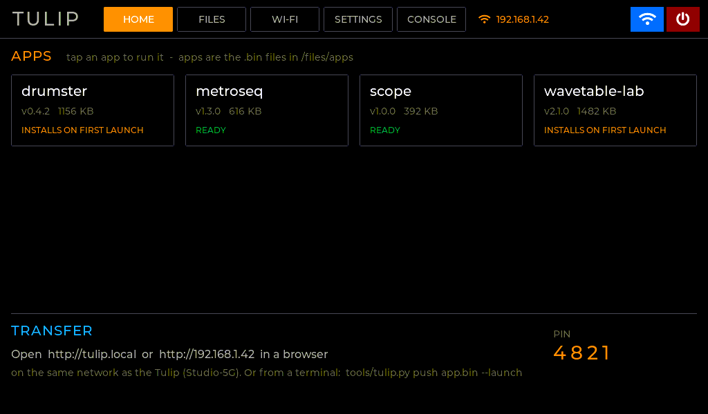
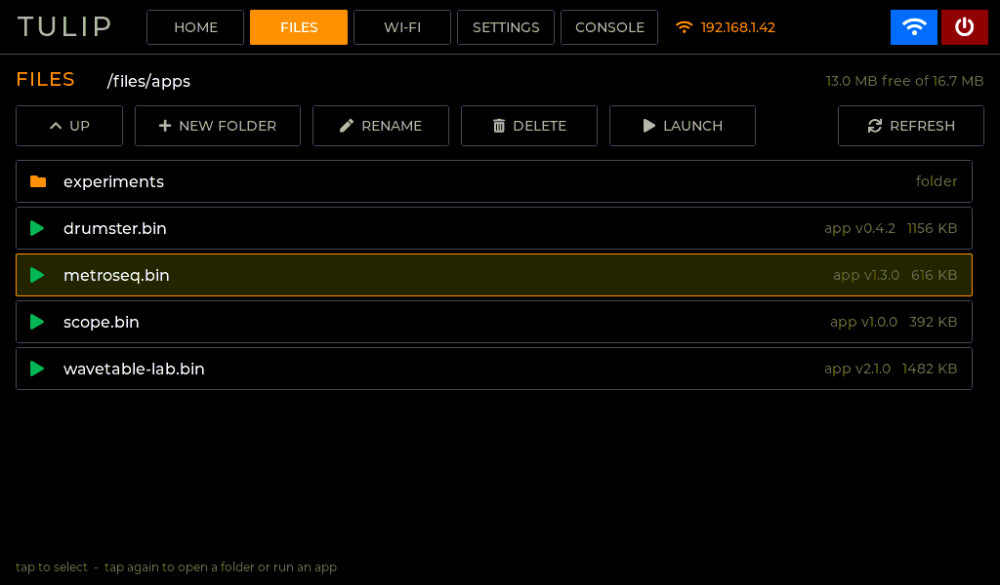
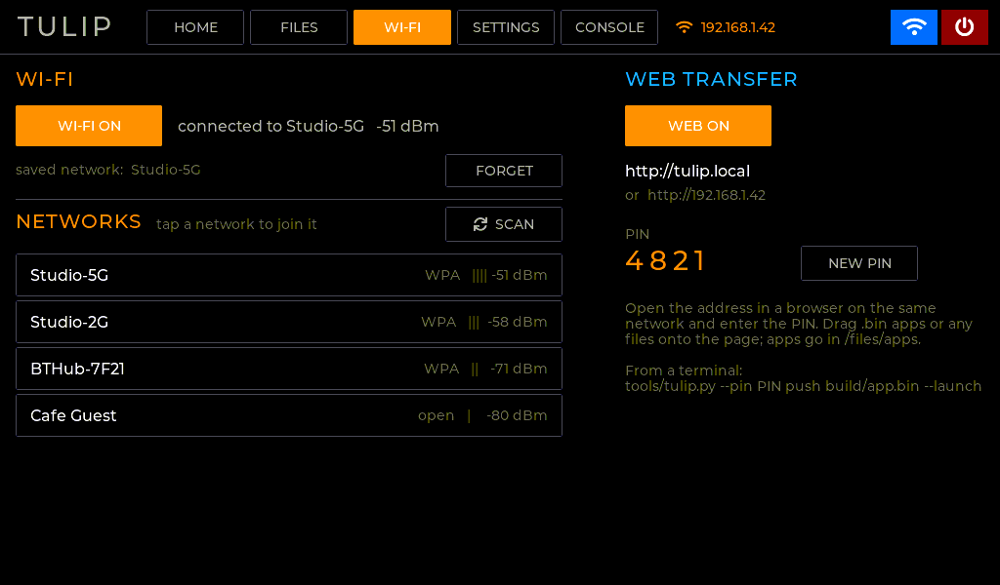
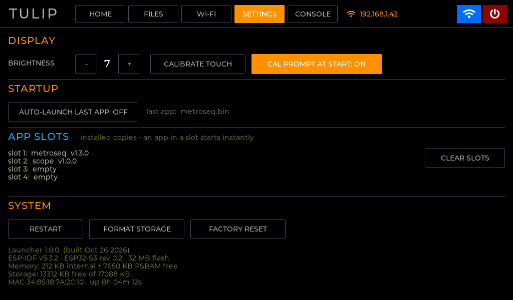
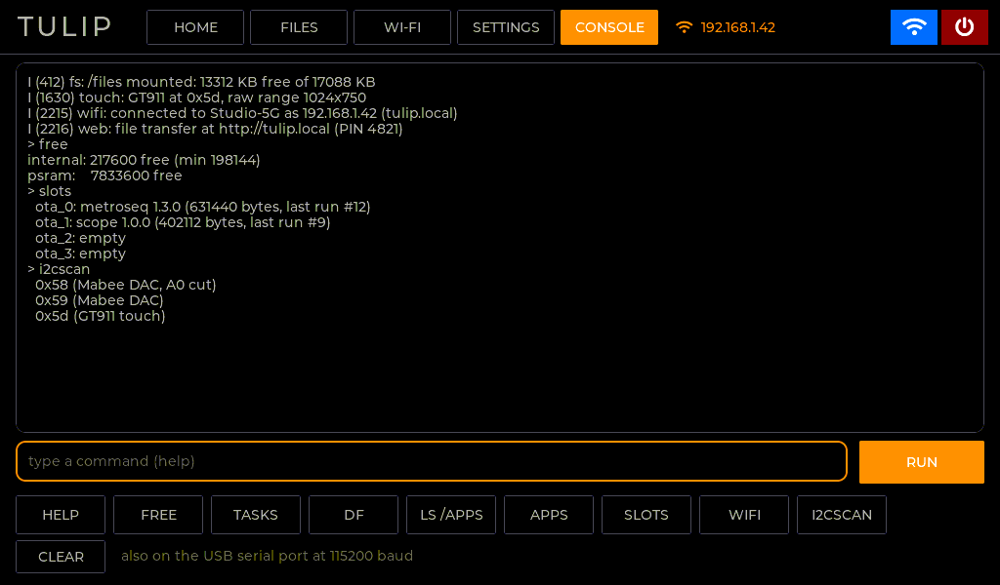
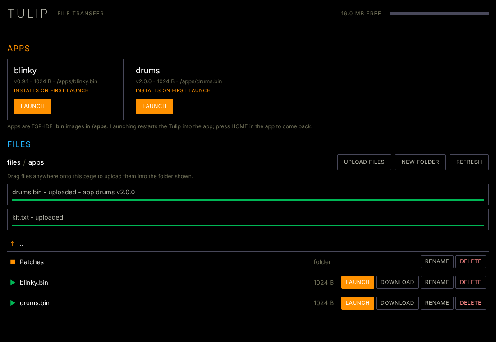

# The Tulip launcher

A C replacement for the Tulip CC's MicroPython desktop. It boots in about a
second and shows your apps. You can launch them, manage files, join Wi-Fi,
calibrate the touchscreen, and use a debug REPL, and you can transfer apps and
files from a browser or a terminal.

| Home | Files |
|---|---|
|  |  |
| **Wi-Fi + web transfer** | **Settings** |
|  |  |
| **Console (debug REPL)** | **Web app (any browser)** |
|  |  |

*(On-device screens are rendered from the launcher's real UI code by `tools/ui_preview`,
through the panel's RGB332 conversion. The web app screenshot is from the end-to-end
test in headless Chromium.)*

---

## 1. How apps work

A **Tulip app is a normal ESP-IDF application image**: the `.bin` that `idf.py build`
produces. It is built on the shared Tulip base (`components/tulip_hal`) and kept in
`/files/apps`.

```
 32 MB flash
 ┌──────────┬─────────┬─────────┬─────────┬─────────┬──────────────────────┐
 │ factory  │ ota_0   │ ota_1   │ ota_2   │ ota_3   │ storage (FAT)        │
 │ launcher │ app     │ app     │ app     │ app     │ /files ~16.7 MB      │
 │ 3 MB     │ slot    │ slot    │ slot    │ slot    │  /files/apps/*.bin   │
 └──────────┴─────────┴─────────┴─────────┴─────────┴──────────────────────┘
```

**Launching.** When you launch an app, the launcher checks whether one of the four
**app slots** already holds that exact build (matched on the ELF SHA-256 the build
embeds, plus size).
* If it does, the launcher reboots straight into that slot. That takes about 1–2 s.
* If not, it copies the image into the least-recently-used slot, with a progress bar.
  `esp_ota_end()` verifies the whole image (segments plus SHA-256) before the slot is
  marked bootable, so a damaged file can never be started.

**Coming back.** Each app calls `tulip_app_init()` first thing, which points the next
boot back at the launcher. So a HOME button, a reset, a crash or a power cycle all land
in the launcher.
* If an app dies before it even gets that far, the bootloader's rollback check returns
  to the launcher instead.
* SETTINGS → *Auto-launch last app* re-runs your app at power-on. A tap during the 3 s
  countdown stays in the launcher.

**Why this design.** While an app runs, it **owns the whole machine**: both cores, all
the RAM, every peripheral. That is what keeps an app like metroseq's real-time
sequencer solid. To have **several apps running together** (metroseq + a drum machine
+ a synth on one clock), they are built into one image as Studio modules: see
[STUDIO.md](STUDIO.md). The full image ships `studio` (all three) as well as `metroseq`
and `gintonix` on their own. The other approaches I considered:

| Approach | Why not (as the main app model) |
|---|---|
| Load app code at runtime (ELF loader / position-independent code) | The app shares the launcher's process: one bad pointer takes both down. You'd need a frozen symbol ABI and heap fragmentation management, and real-time apps would compete with the launcher's Wi-Fi and UI. |
| Compile C on the device (TinyCC, as Tulip does for DSP snippets) | Fine for small scripts, but no optimiser and no ESP-IDF drivers or components. Not suited to full apps. |
| One firmware with every app compiled in | Every new app means reflashing everything over USB, which defeats the file browser. |

## 2. Packaging apps: recommendation

**Ship the plain `.bin` from `idf.py build`, and nothing else.**

* **Name and version come from the image.** The launcher reads the `esp_app_desc_t`
  that ESP-IDF embeds in every image. The `project(...)` name is what the tile shows,
  and `PROJECT_VER` is the version. No manifest or packing tool is needed.
* **Integrity is built in.** The image carries checksums and an appended SHA-256, which
  are verified before a slot is ever marked bootable.
* **Builds are told apart by the embedded ELF hash.** Re-uploading a changed build under
  the same name is detected and re-installed automatically.
* **Use a short, unique project name.** It is what the launcher shows and what the
  `.bin` is called.
* **App data goes in its own folder.** Apps can mount `/files` with
  `tulip_fs_mount(false)` and keep data in `/files/<appname>/`. Settings go in their own
  NVS namespace.

**Requirements for an app:**
1. Build with `components/tulip_hal/sdkconfig.tulip` as the base (`SDKCONFIG_DEFAULTS`).
   It matches the bootloader the launcher installed: octal flash and PSRAM, rollback, and
   XIP from PSRAM. Use the device partition table. `apps/hello` shows the 10-line setup.
2. Call `tulip_app_init()` at the top of `app_main()`, and give the user a way home:
   `tulip_exit_to_launcher()`.
3. Fit in 3 MB (studio, with three apps, is 0.89 MB; the hello app 0.57 MB).
4. **Don't `idf.py flash` an app.** That would overwrite the launcher. Push it instead
   (below).

If you later want an icon or a description on the tile, the natural extension is an
optional sidecar `<app>.json` next to the `.bin`. The launcher doesn't need it today.

## 3. Writing an app

`apps/hello/main/main.c` is the template: display, touch, a button, and HOME. The pieces:

```c
tulip_app_init();              // a reset returns to the launcher
tulip_settings_load();         // device-wide touch calibration + brightness
tulip_input_start(0, 5);       // I2C bus + touch polling
tulip_display_start(&(tulip_display_cfg_t){
    .core = 1, .priority = 4, .ui_create = ui_create, .ui_poll = ui_poll});
```

`tulip_hal` gives every app:
* the RGB332 panel with LVGL 9 (pick the core);
* GT911 touch with the shared calibration and the calibration screen
  (`tulip/touchcal_ui.h`);
* the shared I2C bus;
* `/files` access;
* shared settings;
* the app lifecycle.

Apps that need to schedule the I2C bus themselves (metroseq keeps CV writes on time by
polling touch only in gaps) create the bus and call `gt911_poll()` themselves instead of
using `tulip_input_start()`.

Develop with:

```sh
cd apps/hello
idf.py build && ../../tools/tulip.py --pin 4821 push build/hello.bin --launch
```

## 4. Moving files to and from the Tulip

**On the Tulip.** WI-FI → SCAN → tap your network → type the password. The page then
shows `http://tulip.local`, the IP address, and a 4-digit **PIN**. HOME shows them too.

* **Browser:** open `http://tulip.local` (or the IP), enter the PIN, and drag files onto
  the page. Uploads show progress. You can make folders, rename, download, delete, and
  launch apps.
* **Terminal:** `tools/tulip.py` (Python standard library only):
  ```sh
  export TULIP_PIN=4821            # and TULIP_HOST if tulip.local doesn't resolve
  tulip.py info                    # apps, storage
  tulip.py push build/myapp.bin --launch
  tulip.py push samples/*.wav --to /samples
  tulip.py ls /apps ; tulip.py pull /samples/kick.wav ; tulip.py rm /old
  ```
* **The API** (for your own tools) is plain HTTP + JSON with an `X-Tulip-Pin` header. It
  is documented in `launcher/main/web.h`.

**Safety.**
* The PIN is required for every API call, and 5 wrong PINs lock the API out for 30 s.
* Every path is resolved inside `/files`, so `..` escapes are refused (unit-tested).
* Uploads go to a temp file and are only renamed into place when complete.
* `/files/apps` and `/files` can't be deleted.

**Limits.**
* It is plain HTTP for your local network: don't port-forward it.
* The Wi-Fi password is stored in NVS unencrypted, like most ESP32 devices.

## 5. Settings and the debug REPL

* **SETTINGS:**
  * brightness;
  * *Calibrate touch*, the 5-target calibration, which is shared by all apps;
  * *Cal prompt at start*, the offer at power-on to calibrate (tap left) or skip (tap
    right, or wait 5 s);
  * auto-launch;
  * the app-slot table, with CLEAR SLOTS;
  * RESTART, FORMAT STORAGE and FACTORY RESET, all confirmed. FACTORY RESET erases
    settings but keeps your files.
* **CONSOLE**, the debug REPL. The same commands work on screen (with the keyboard and
  quick buttons) and on the USB serial port at 115200 baud. The system log is mirrored
  on screen.

  `help ver free tasks uptime df ls cat mkdir rm mv apps slots launch parts wifi i2cscan bright cal reboot format factory-reset`

  `i2cscan` names the GT911 and Mabee DACs it finds.

## 6. First flash and recovery

Flash `tulip-full.bin` once over USB (`esptool.py --chip esp32s3 write_flash 0x0
tulip-full.bin`). It contains the bootloader, the partition table, the launcher, and
**studio, metroseq, gintonix and sloe preloaded** in slots 1–4. On first boot the launcher
formats `/files`, then copies them into `/files/apps`, so they show up straight away.
This takes up to a minute; the screen shows its progress.
After that, apps only ever arrive over Wi-Fi or USB serial.

> This replaces the Tulip firmware *and* its `/user` filesystem region. Back up your
> `/user` files before the first flash. To go back to Tulip, flash a Tulip
> `tulip-full-XXX.bin` at 0x0.

Build the image yourself with `tools/make_full_image.sh`.

## 7. Threads and cores

| Core 0 | Core 1 |
|---|---|
| Wi-Fi, lwIP, web server, mDNS | LVGL UI and the panel's bounce-buffer interrupt |
| installer, console task, USB REPL | touch polling |

Radio traffic and web uploads never share a core with the panel interrupt, so the
display doesn't stutter during transfers.

## 8. What's verified, and what needs a Tulip

Verified here without hardware:
* **Builds:** launcher, metroseq and hello all build with no warnings. The launcher is
  1.33 MB of its 3 MB slot.
* **Launcher logic (host tests):** path safety (escapes, bad names, truncation), app
  image parsing (including the real `metroseq.bin`), and slot selection.
* **Transfer (end-to-end):** `tools/tulip.py` and the web app in headless Chromium,
  against `tests/web_mock.py`, which implements the same API rules. Covered: PIN gate,
  uploads, folders, rename, delete, download, launch, refusing `..` escapes and wrong
  PINs. That test found and fixed a CSS clash in the web app.
* **Merged image:** the partition table, the launcher in factory, and metroseq in ota_0
  (checksum and SHA-256 valid) were inspected.
* **Screens:** every launcher screen was rendered through the panel's colour conversion
  and checked.

Needs a real Tulip:
* first-boot format and import;
* Wi-Fi join and `tulip.local` resolution on your network;
* real upload speed (expect hundreds of KB/s);
* the slot install and reboot round-trip;
* HOME from metroseq.

The ESP-IDF APIs involved are standard, but none of this has run on the device yet.
