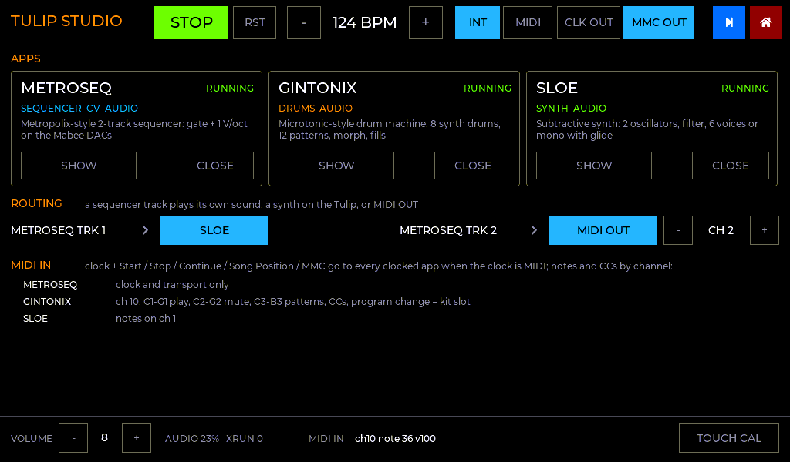
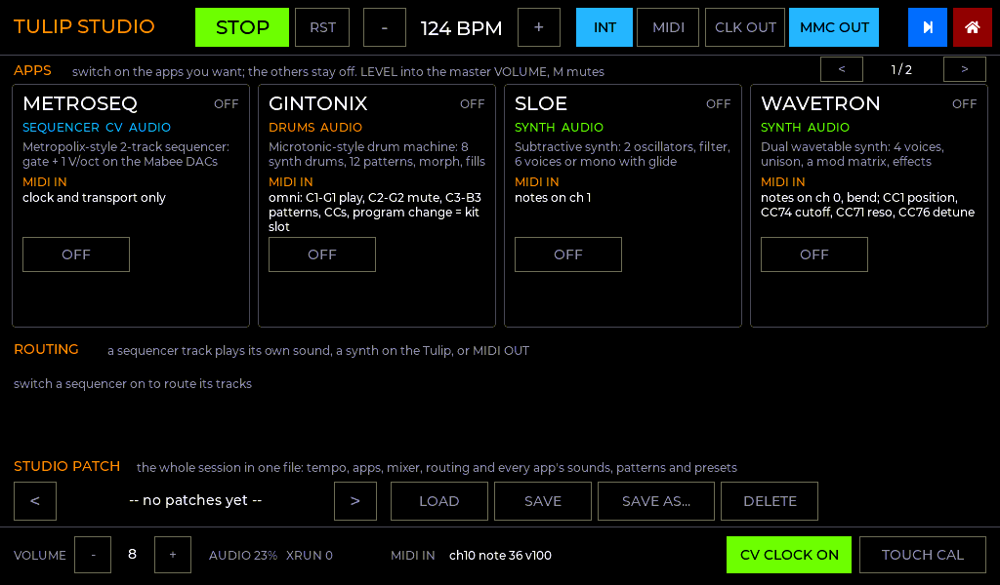
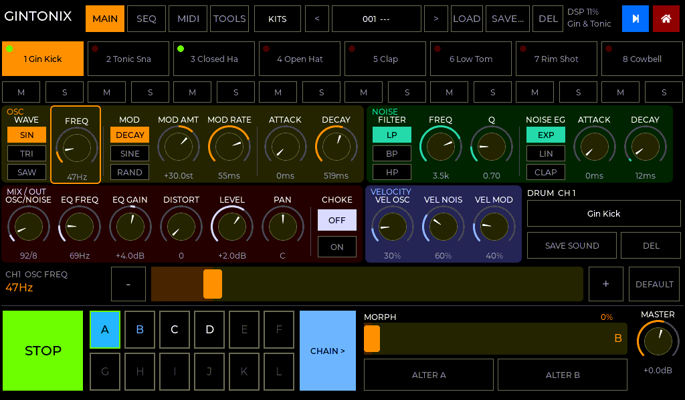
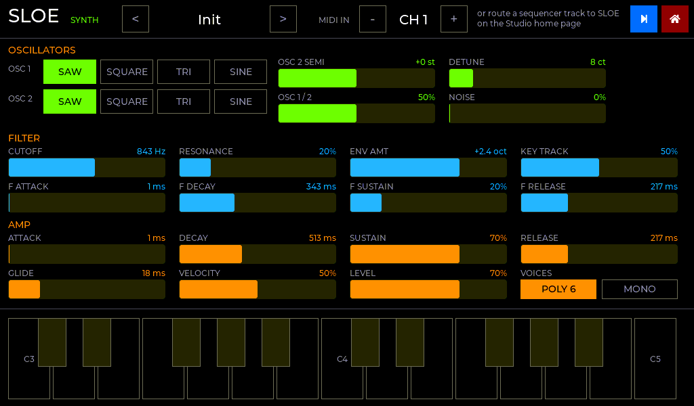

# Tulip Studio: several apps at once, on one clock

**Tulip Studio** is one firmware holding every app: metroseq (CV sequencer), GinTonix and
Drumster9 (drum machines), Sloe and Wavetron (synths). The same apps run two ways:

* **On their own:** a tile each on the launcher's start page.
* **In the Studio:** the STUDIO tile. The apps you switch on run at the same time, all
  playing to **one master clock**.
  * Every app starts **OFF**, and only those you switch on use any CPU, RAM or audio
    time.
  * You switch between their screens with the **blue square** in the top-right corner,
    as on the original Tulip.
  * The apps you aren't looking at keep playing.

New apps slot into both: see **[APPS.md](APPS.md)**.

* **One tempo, one transport.** PLAY anywhere starts everything on the same downbeat.
  MIDI clock, Start / Stop / Continue, Song Position and MMC drive every app at once.
* **Each app has a role tag**, which tells the runtime what to give it (see the table
  below).
* **Internal routing.** A metroseq track can play Sloe or Wavetron on the Tulip, go out of MIDI OUT,
  or keep its own preview sound. metroseq's SLIDE becomes a glide on the synth.

| Studio home: apps switched on | At start: every app off |
|---|---|
|  |  |

| GinTonix | Sloe |
|---|---|
|  |  |

*(Device screens are rendered from the real UI code by `tools/ui_preview`.)*

---

## 1. Using it

From the launcher's start page, tap **STUDIO**. (Tap an app's own tile to run it on its
own instead.)

* **Blue square:** the next app that is on, then the Studio home page, round and round.
  Hold it to go straight to the home page.
* **Red square:** the Studio home page. On the home page itself, the red square goes
  back to the launcher. Leaving stops the transport and waits for any save in progress.

**The home page:**

* **Top bar:**
  * **PLAY/STOP and RST:** RST starts again from the top, or re-arms when following
    MIDI.
  * **Tempo:** `-` / `+` buttons (hold to repeat).
  * **Clock source:** **INT** or **MIDI**.
  * **CLK OUT:** sends MIDI clock and Start/Stop from the internal clock.
  * **MMC:** MMC IN when following MIDI, MMC OUT when running on the internal clock.
* **APPS:** a tile for each app, with its role tags, four at a time. The `<` `>` arrows
  show the next four.
  * **ON / OFF** switches the app on (it starts the first time) or off. An app that is
    off drops its gates low, stops sounding and gets no CPU time.
  * **SHOW** goes to an app that is on.
  * The **mixer strip** (level, mute, peak meter) shows while the app is on.
* **ROUTING:** where the notes of each track of every sequencer that is on go. Four
  tracks show at a time, with arrows for more; a new sequencer app gets rows too:
  * **OWN SOUND:** metroseq's preview voice.
  * **SLOE** (or any synth app).
  * **MIDI OUT:** on a channel you choose, which defaults to the track number.
* **MIDI IN:** which app listens to what. Notes and CCs go to each app on its own
  channel.
* **STUDIO PATCH:** the whole session in one file (see below).
* **Bottom bar:**
  * master volume;
  * audio load and underrun count;
  * the last MIDI message received;
  * **CV CLOCK:** the drum machines' clock on the Mabee DAC (its rate and VOUT1 are on
    each drum machine's settings page);
  * **TOUCH CAL**.

The tempo, clock and routes are saved and come back the next time you open Studio.
Studio always starts on this home page, with every app off. A Studio patch switches on
the apps it was saved with.

### Studio patches

A Studio patch is everything at once, saved as one JSON file you can load later:

* the tempo and master volume;
* which apps are on, and each app's mixer level and mute;
* the routing of every sequencer track (to a synth, or MIDI OUT and its channel);
* each app's own state:
  * **metroseq:** the pattern, all 10 presets and the one playing, the preview on/off;
  * **GinTonix:** the kit with its 12 patterns (what the bank's SAVE writes), and its
    MIDI channel;
  * **Sloe:** the sound, its preset name and its MIDI channel;
  * **Wavetron:** the sound (its wavetables by path, as its own patches do), its name
    and its MIDI channel;
  * **Drumster9:** everything a Drumster9 project holds (the grid, the A-J patterns,
    the kits and their samples, the buses, the mix), and its MIDI channel.

On the home page: `<` `>` pick a patch, **LOAD** loads it, **SAVE** writes over the one
picked, **SAVE AS...** asks for a name, and **DELETE** (tap twice) removes it.

The files are `/files/studio/patches/<name>.json`, indented so you can read them, and the
launcher's Wi-Fi page can copy them on and off. Apps are found by name, so a patch from
one Studio image loads in another: an app it doesn't know is skipped, and keys that are
missing keep their defaults. The clock source and touch calibration belong to the
Tulip, not the patch.

### The two ways to set it up that you asked about

1. **metroseq as the master, the drums following.** Leave the clock on **INT**. PLAY in
   either app starts both on the same downbeat, and tempo changes in one are heard in
   the other. With **CLK OUT** on, external gear follows too.
2. **An external master over MIDI.**
   * Set the clock to **MIDI**. MIDI Start, Stop and Continue run metroseq and the drums
     together, and both follow the master's clock.
   * Notes on Sloe's channel (default 1) play Sloe. Notes on GinTonix's channel
     (default 10) play and mute drums and pick patterns.

## 2. Roles (the app tags)

| Tag | Gets from the runtime | Gives | Example |
|---|---|---|---|
| **SEQUENCER** | the master clock's pulses (exact time of every 1/16) and transport; MIDI clock in and out | CV gate + pitch (`CV`); note tracks to route to a synth or MIDI OUT | metroseq |
| **DRUMS** | the clock's timeline and transport; MIDI clock in and out; MIDI notes and CCs on its channel; the **CV clock** | audio | GinTonix, Drumster9 |
| **SYNTH** | routed notes from sequencer tracks; MIDI notes on its channel | audio | Sloe, Wavetron |

**The CV clock** is the runtime's, for every drum machine:

* **Where:** the Mabee DAC at 0x59. VOUT0 is a square-wave clock locked to the grid
  (1/16, 1/8 or 1/4). VOUT1 gives a reset pulse each bar, or stays high while running.
* **When:** while a drum machine is on, unless a sequencer that drives the DACs is on
  too. Its gate and pitch win.
* **Settings:** set it on any drum machine's settings page or the Studio home page.

Two flags sit alongside the role. `AUDIO` means the app renders into the mix. `CV` means
the app owns the Mabee DACs, and only one app may.

## 3. One image for every app

Two separate `.bin` apps can't run at the same time. The ESP32-S3 boots **one** firmware
image, and it has no memory protection to keep two separately-built programs apart. So
every app is a **module**: an ESP-IDF component in `modules/`, compiled into the one
Tulip Studio image (`apps/studio` → `studio.bin`).

The same image runs an app on its own or the Studio:

* **The launcher says which.** Before booting it, it stores a **boot mode** in NVS
  (`tulip_boot_mode_set()`): an app's name, or `""` for the Studio.
* **On its own:** `studio_run()` cuts the module list down to that app and starts it at
  once. It has its own settings and the red square goes back to the launcher.
* **In the Studio:** nothing starts until you switch it on.

**How the launcher knows what's inside:**

* The build generates the app list from every `modules/*/app.json`.
* It places that list (a **manifest**, `tulip/app_manifest.h`) right after the app
  description in `studio.bin`.
* The launcher reads it and shows a tile per app.

**Adding an app** is a folder in `modules/` and a rebuild; nothing else is edited.
The rebuild can happen on GitHub (the cloud build). As an experiment, an app can
instead be built as an `.elf` and loaded from `/files/studio/apps` when Tulip Studio
starts. [APPS.md](APPS.md) covers both.

## 4. How it works

### 4.1 Tasks and cores

| Task | Core | Priority | Runs |
|---|---|---|---|
| `rt` | 1 | 23 | the master clock; each sequencer's engine; CV and touch on the I2C bus; MIDI OUT |
| `midi` | 1 | 22 | MIDI IN, timestamped per byte. Clock and transport go to `rt`; channel messages go to the apps |
| `audio` | 1 | 21 | every app's `render()`, mixed and sent to the I2S DAC |
| `lvgl` | 0 | 4 | every app's screen, touch, the panel interrupt |
| app tasks | 0 | low | file and flash writes |

The `rt` task is metroseq's old sequencer task, now shared, with the same timing design
([INVESTIGATION.md §3](INVESTIGATION.md#3-design-for-solid-timing)). It sleeps on a
GPTimer alarm until 40 µs before the next deadline, spins to it, and is the only user
of the I2C bus. Touch is read only in gaps longer than a worst-case touch read.

### 4.2 One master clock (`components/tulip_studio/src/tclock.c`)

* **Internal clock.**
  * Each 1/16 is computed from an anchor: `t = anchor + n × 1/16`. The times are never
    summed, so they can't drift.
  * A tempo change keeps the song position continuous.
  * PLAY puts the downbeat **20 ms** ahead, so the audio apps (which render a few ms
    ahead) can place it on the exact sample.
* **MIDI clock.** Hard sync, soft tempo, as metroseq had before:
  * every 6th clock is a 1/16 pulse at that clock's own arrival time;
  * the 1/16 length between pulses comes from the average over the last beat;
  * Start, Continue, Stop, Song Position and MMC Play / Stop / Locate are followed.
* **Two ways to listen:**
  * **Sinks** (sequencers): called inside the `rt` task at the exact time of each
    pulse, plus start, stop, continue and locate. metroseq's engine is driven this
    way. `seq_clock.c` maps the clock onto the engine.
  * **The timeline** (audio apps): a tiny published record, "song position P was at
    time T, a 1/16 lasts D µs". An audio task reads it lock-free and works out the
    time of any step, swung step, triplet or flam itself. Nothing is pushed to it, so a
    busy audio block can't make a pulse late, and a late block can't shift the grid.

### 4.3 Audio (`components/tulip_studio/src/audio.c`)

* **Format:** 44.1 kHz stereo, 16-bit, with a DMA ring of 4 × 48 frames (4.4 ms).
* **Each block knows when it will be heard.** A block carries the clock time at which
  its first frame reaches the DAC. That time comes from a phase-locked estimate:
  * each block measures when its DMA buffer was taken;
  * a slow first-order loop filters out wake-up jitter and tracks any rate difference
    between the I2S clock and the 1 MHz timer.
* **Drums land on the grid.** GinTonix converts each hit's grid time to a frame, so its
  hits sound on the sample where the clock puts the step, together with metroseq's
  gates.
* **Mix and DSP load:**
  * The mix is limited with a soft knee above −2 dB.
  * The whole audio path renders from internal RAM, not through the PSRAM cache: the
    Studio mixer, GinTonix's engine and sequencer, Sloe's voices, Wavetron's engine and
    effects, and metroseq's preview voice (`IRAM_ATTR`, or the module's `linker.lf`).
    Otherwise redrawing the screen on core 0 evicts the audio code from the shared
    instruction cache, and every setting change crackles. The instruction cache is
    32 KB in the apps (16 KB in the launcher).
  * On the host, 8 drum voices take about 1 % of one core. On the ESP32-S3 my estimate
    is 10–25 %; the home page shows the real figure (AUDIO %).

### 4.4 Routing notes (`studio_note_out()`)

* **The path:**
  * metroseq's engine emits a note-on and note-off for each track gate.
  * The `rt` task executes them **at their due time** (as it does for CV) and hands
    them to the routed synth's queue, or writes them to MIDI OUT.
  * A stage with SLIDE carries its glide time, and Sloe glides from that track's
    previous note.
* **Latency:**
  * A routed note sounds at the **start of the synth's next audio block**: about
    **4 ms after the CV gate**, the length of the audio buffer.
  * Drums don't have this delay: GinTonix places hits ahead of time from the timeline.
  * MIDI OUT notes leave on time.
  * 4 ms is less than a MIDI note takes on a DIN cable (≈1 ms) plus a typical
    hardware synth's response. A further step would be to run the sequencer engine
    one buffer ahead for routed tracks only; it isn't done, so the CV path stays as
    tested.

### 4.5 Memory

LVGL allocates from the 8 MB PSRAM (`components/tulip_hal/src/lv_mem_psram.c`), as on
the original Tulip. Several apps' screens therefore fit without eating the internal RAM
that DMA, stacks and the real-time code need. The Studio image (all five apps) uses 265 KB of 342 KB
internal RAM statically, and about 1.0 MB of its 1.5 MB app slot.

## 5. Writing an app

See **[APPS.md](APPS.md)**: the `tmod_t`, what each role gets, the rules that keep the
timing solid, and a template to copy (`docs/templates/mod_example`).

## 6. Verified here, and what needs a Tulip

**Verified without hardware** (`make -C tests test`; `tools/ui_preview`):

* **The master clock:**
  * the exact grid on the internal clock, and clock out with 6 clocks per 1/16 on the
    grid;
  * the timeline agrees with the pulses;
  * the song position stays continuous through a tempo change;
  * a 1 s stall resyncs instead of bursting.
* **MIDI clock:**
  * the downbeat lands on the first clock after Start;
  * pulses come on every 6th clock's own timestamp;
  * Song Position + Continue lands on the right 1/16;
  * MMC Play / Stop / Locate;
  * the tempo follows hiccups and tempo changes.
* **metroseq on the shared clock is identical to before:** on 20 random patterns, all
  16,821 CV events matched to the microsecond against the engine's own clock. The
  Python parity tests still pass.
* **GinTonix:** see [GINTONIX.md](GINTONIX.md#verification).
* **Sloe:**
  * every preset sounds and releases;
  * a routed SLIDE glides;
  * voice stealing and all-notes-off work.
* **Builds:** the launcher and Tulip Studio build with no warnings. Adding a module folder
  (the template) puts it in the image and the manifest with no other edit.
* **The manifest:** parsed from a real `studio.bin` (`tests/test_launcher.c`).
* **Screens:** every screen renders.

**Needs a Tulip:**

* the audio path for real: levels, load (shown on the home page), no underruns with
  all three apps playing;
* that the drums and metroseq's gates line up on a scope or in a recording;
* MIDI IN and OUT on the DIN ports;
* that touch stays smooth with three apps' screens in PSRAM.
