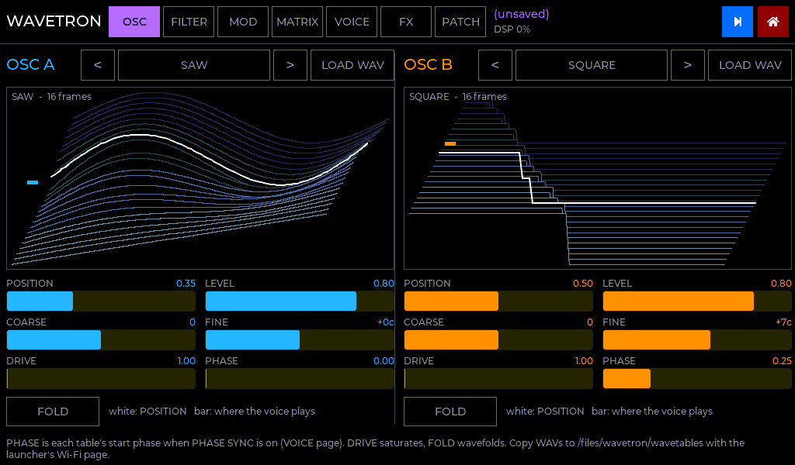
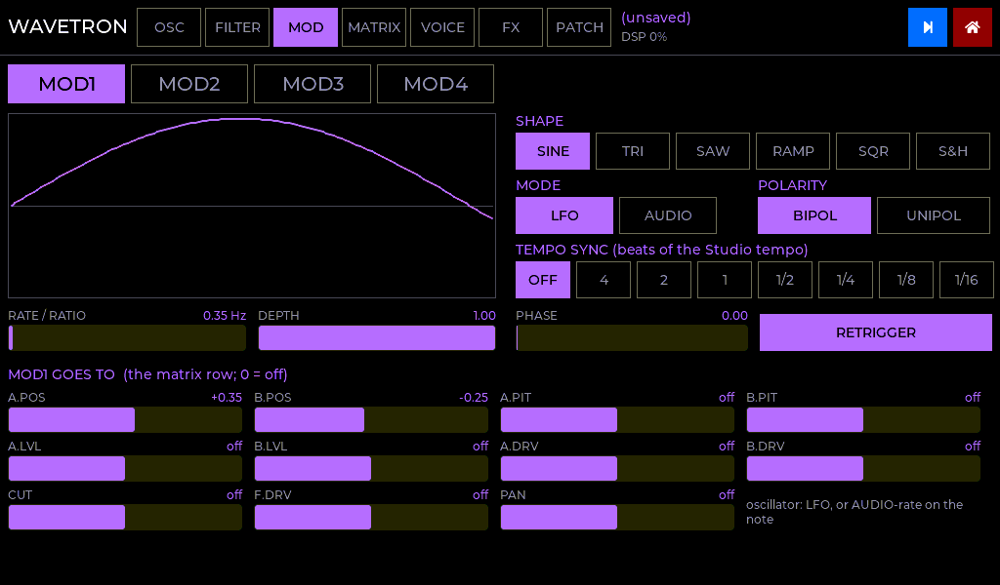
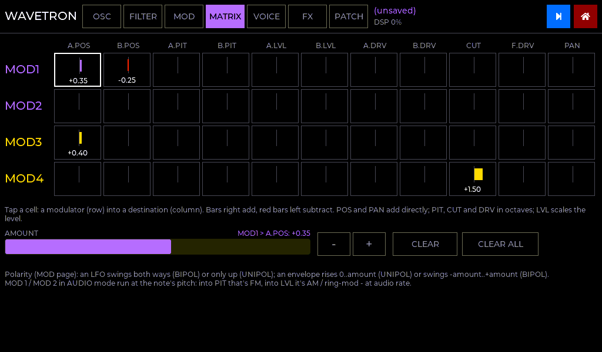
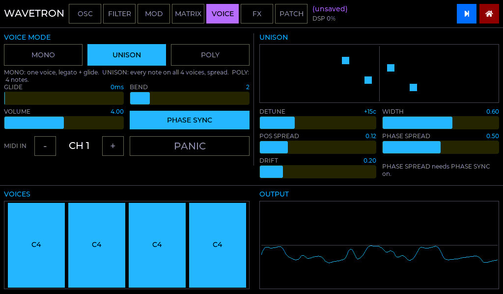
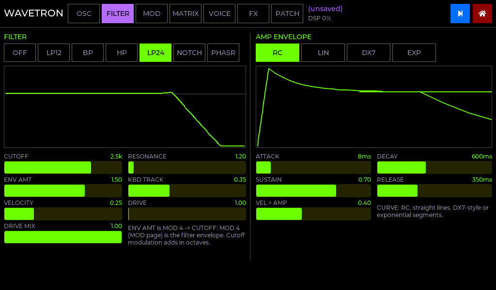
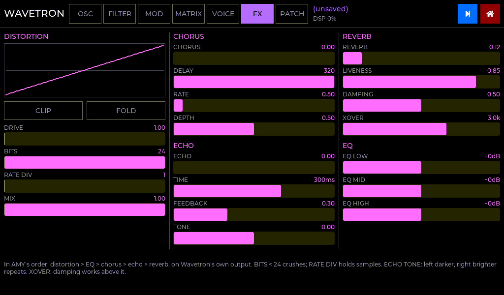

# Wavetron in C

A native port of the AMYboard sketch [`reference/wavetron/wavetron_v1_2.py`](../reference/wavetron/wavetron_v1_2.py), the dual wavetable synth that was
designed for a 1.5" OLED and eight encoders. It's a Studio app (role: **SYNTH**), so it
runs in two ways:

* **STUDIO:** alongside the other apps, on one clock. A metroseq track can play it
  ([STUDIO.md](STUDIO.md)).
* **WAVETRON:** on its own, from its tile on the launcher's start page.

| OSC: the 3-D waterfall | MOD |
|---|---|
|  |  |
| **MATRIX** | **VOICE** |
|  |  |
| **FILTER + AMP** | **FX** |
|  |  |

*(Rendered from the real UI code by `tools/ui_preview`.)*

## From fifteen OLED pages to seven touch pages

Every parameter the sketch had is here, with its key, range, step and default. The page
title in the header shows the patch name and the DSP load.

| Page | The sketch's pages | What's on it |
|---|---|---|
| **OSC** | OSC A, OSC B, WT LOAD | Both oscillators side by side. Each has a table selector (`<` name `>`), **LOAD WAV**, the 3-D waterfall, and POSITION, LEVEL, COARSE, FINE, DRIVE, PHASE and FOLD |
| **FILTER** | FILTER, ENV | Filter type (OFF LP12 BP HP LP24 NOTCH PHASR) with a response curve; cutoff, resonance, env amount, key tracking, velocity, drive and drive mix. The amp envelope with its curve (RC LIN DX7 EXP) and VEL > AMP |
| **MOD** | MOD 1-4 | One tab per modulator. MOD 1 and 2 have shape, LFO / AUDIO mode, rate (or ratio), depth, phase, tempo sync, polarity and retrigger. MOD 3 and 4 are envelopes with curve, velocity and polarity. Under each is the matrix row for that modulator |
| **MATRIX** | MATRIX | The whole 4 x 11 grid at once: tap a cell, then set its amount. Also CLEAR and CLEAR ALL |
| **VOICE** | MIX, UNISON | MONO / UNISON / POLY, glide, bend range, volume, phase sync, MIDI channel and PANIC. Unison detune, width, position spread, phase spread and drift, with a picture. The 4 voices and the live output |
| **FX** | DRIVE, FX, REVERB | Distortion (drive, clip, fold, bits, rate, mix, with its transfer curve), chorus, echo, reverb and a 3-band EQ |
| **PATCH** | the patch page | 24 slots: LOAD, SAVE AS, SAVE OVER, RENAME, DELETE (tap twice), INIT SOUND |

**The 3-D waterfall** is the sketch's topographic view, enlarged. It shows every frame of
the table as a waveform line, receding with a parallax skew, with nearer frames hiding the
ones behind. The terrain is drawn from the table's own samples, so the picture and the
sound always agree. **White** is POSITION. **The oscillator's colour** is where the most
recent voice really is after its modulation, and it moves as an LFO or envelope sweeps the
table.

## Wavetables

* **Built-in:** the sketch's six generated tables, SAW, SQUARE, HARM, VOX, FOLD and BELL,
  16 cycles each. Each cycle is normalised on its own, so POSITION changes the timbre, not
  the volume.
* **Your own:** any WAV of at least two 256-sample cycles: 8, 16, 24 or 32-bit PCM, 32-bit
  float, or WAVE_FORMAT_EXTENSIBLE, mono or stereo. That covers what Serum, Vital and
  WaveEdit export, and ordinary samples too. Long files are capped at 256 cycles.
  * Copy them to **`/files/wavetron/wavetables`** with the launcher's Wi-Fi page. LOAD WAV
    opens a browser there; it can go into any folder in `/files`.
  * Four files stay in RAM at once (least recently used goes first). Tapping a table's name
    lists everything that's loaded.

## Patches: your sketch patches load as they are

The file is **`/files/wavetron/wt_patches.json`**, in the sketch's own format. Copy your
AMYboard's `/user/wt_patches.json` there and the patches load.

* A table is stored by **path**, not by number. A sketch patch names its table by its SD
  path (`/sd/...`). If that path doesn't exist on the Tulip, Wavetron looks for the same
  file name in `/files/wavetron/wavetables`, then at the top of `/files`. If it's still
  missing, it says so and uses a built-in table.
* Keys a patch doesn't have take their default (the sketch's rule), so loading an old patch
  never inherits settings from the previous one.
* The MIDI channel belongs to the setup, not the sound: loading a patch keeps it.
* The current sound is saved by itself in `/files/wavetron/state.json`.
* Before this update the apps' `/files` only knew 8.3 file names, so `wt_patches.json`
  and the `wavetables` folder couldn't be created there. Both work now.
* A Studio patch carries the current sound too ([STUDIO.md](STUDIO.md#studio-patches)).

## MIDI

Notes on Wavetron's channel (the VOICE page, default 1), plus pitch bend (range on the VOICE
page). The sketch's CCs:

| CC | |
|---|---|
| 1 (mod wheel) | OSC A and B position |
| 74 | cutoff |
| 71 | resonance |
| 76 | unison detune (the macro) |
| 120, 123 | all notes off |

On the Studio home page, routing a metroseq track to **WAVETRON** plays it from the sequencer.
A SLIDE stage glides.

## Keeping it light next to the other apps

Four apps share one audio core, and the panel shares the PSRAM bus with everything. So:

* **The audio code runs from internal RAM, not PSRAM.** The apps' code normally sits in
  PSRAM and runs through a small instruction cache shared by both cores. Redrawing the
  screen on one core pushed the audio code out of that cache, and the audio core then
  stalled while it was fetched again from PSRAM. That's why changing settings in any app
  crackled. Wavetron's engine and effects, GinTonix's engine and sequencer, metroseq's
  preview voice and the Studio mixer are now linked into internal RAM (each module's
  `linker.lf`), so the screen can't evict them. The instruction cache is also 32 KB
  instead of 16 KB for the rest of the code.

* **Silent costs nothing.** Once no voice is sounding and every echo and reverb tail is
  below -100 dB, Wavetron stops rendering until the next note.
* **The waterfall redraws only when it changes:** when the table or POSITION changes. The
  playing voice's position is a small bar beside the frames that moves on its own; it
  used to be a second line that redrew the whole picture 20 times a second.
* **The reverb and chorus lines are in internal RAM** (16-bit, about 30 KB). The reverb is
  4 combs + 2 all-passes per side (Freeverb uses twice that).
* **Per-voice coefficients are worked out when something changes,** not every control period:
  the envelopes, filter and pan. Fast exponentials replace the C library's `powf` /
  `expf` / `tanf` in the audio path.
* **The control rate is every 32 samples (0.7 ms)**: envelopes, LFOs and the matrix
  step there, and the oscillators and filters run per sample in between.
* **The scope runs at 10 Hz, and the voices display only redraws when a note changes.**

## What's different from the sketch, and why

| | Sketch (AMY) | C |
|---|---|---|
| **Sound** | AMY oscillators: four 1-voice synths of 5 oscillators each | A native engine, with the same architecture and the same three voice modes over 4 fixed voices |
| **MOD 1 / 2 in AUDIO mode** | "FM / RM" at AMY's block rate: an aliased, control-rate approximation (the sketch says so) | **True audio-rate FM / AM**: the operator runs per sample on the note's pitch |
| **Matrix reach** | MOD 3 only reached the oscillators and MOD 4 only the filter head (an AMY limit) | Every modulator reaches every destination |
| **Effects** | AMY's bus effects | Written in C for it, in AMY's order: distortion, EQ, chorus, echo, reverb. They're Wavetron's own, not shared with the other apps |
| **Tempo sync** | Its own TEMPO row | The Studio's master tempo (also MIDI clock) |
| **CV** | CV1 gate / CV2 pitch in, MOD to CV out | Not ported, as asked: the Tulip's DACs belong to metroseq |
| **Unison drift** | Pushed from Python 4 times a second | Computed in the engine, smooth |
| **Glide** | AMY portamento | The same in every mode, and a routed SLIDE uses its own time |

## Verification (`make -C tests test`)

* **Tables:** 6 built-ins x 16 cycles, each normalised to 0.95; SAW is a sine at position 0;
  POSITION crossfades.
* **Pitch:**
  * A4 plays at 440.01 Hz;
  * COARSE + FINE are exact;
  * bend +2 semitones.
* **Envelopes:** LIN attack and release timings; all four curves reach their sustain and
  release to silence.
* **Voices:** POLY steals the oldest; MONO is legato and falls back to the held note; glide;
  UNISON plays 4 voices in stereo.
* **Filters:** all six are stable at resonance 4, and LP24 darkens. An LFO sweeps the
  position, and audio-rate FM spreads the spectrum.
* **Effects:**
  * the echo lands at its time;
  * the reverb has a tail;
  * PANIC silences it;
  * everything at once settles.
* **WAV:** every format above loads; a short file or a non-WAV is refused with a reason;
  the LRU keeps 4 files.
* **Patches:** a record exactly as the sketch writes it (MOD4 -> CUT as `3:cut`, keys the
  C side doesn't have, keys it lacks) loads; round trip; the 24-slot library.
* **CPU:** the worst case (4 voices, FM, drive, fold, every effect) takes about 4% of real
  time on a PC.

**Needs a Tulip:** listening; the DSP load next to GinTonix and Sloe (the header shows
Wavetron's own); levels against the AMYboard.
